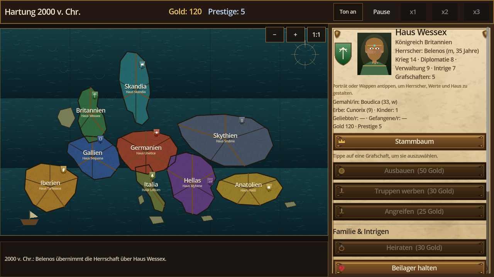
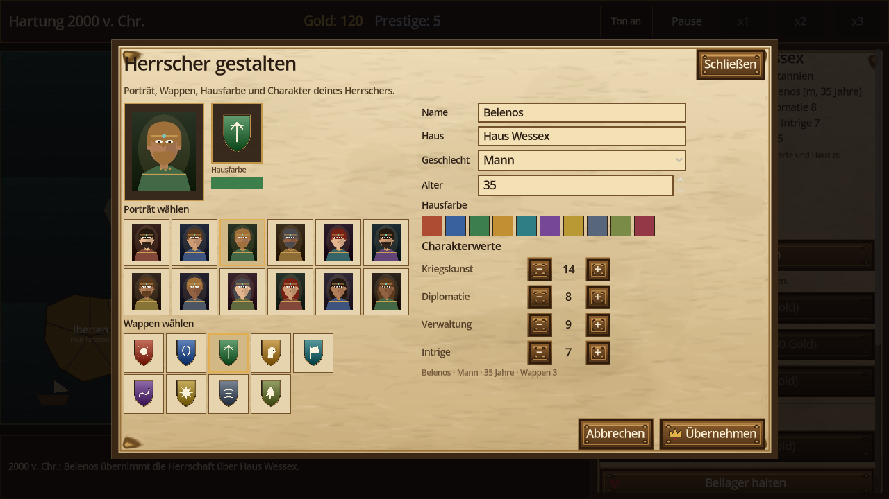
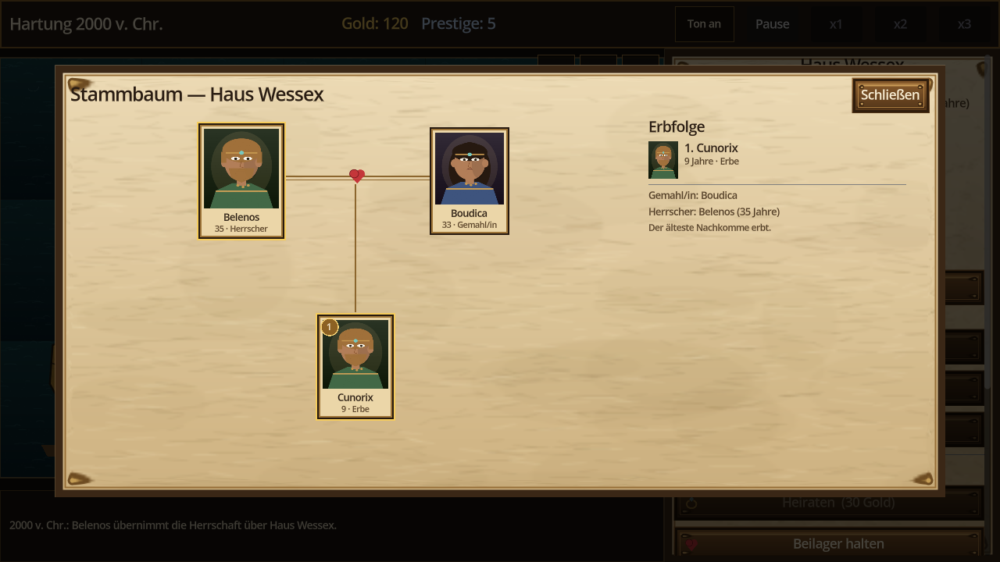

# Kronen und Kriege

Bronzezeit-Grand-Strategy für **Android und Windows**, gebaut mit Godot 4.5. Kein Port von Crusader Kings: eigener Code, eigene Grafiken, keine Fremdassets. Die Partie beginnt **2000 v. Chr.** auf einer städtischen Europakarte mit 49 Grafschaften in 29 Herzogtümern, neun Königreichen und drei Reichen.







## Architekturstand Welle 4

Die systemische Tiefe ist in versionierten Dokumenten festgehalten:

- [`docs/waves.md`](docs/waves.md) — Wellenplan und Exit-Gates
- [`docs/ui-kernel.md`](docs/ui-kernel.md) — UiKernel-Zuschnitt und abgeschlossene Extraktion
- [`docs/depth-contract.md`](docs/depth-contract.md) — Depth Contract und 30-Minuten-Messlatte
- [`docs/interaction-matrix.md`](docs/interaction-matrix.md) — Kanten der vier Säulen mit Quelle, Ziel und Zustandsgröße
- [`docs/save-schema.md`](docs/save-schema.md) — Schema 4, Migration und Nachweis

Der Save ist migrationfest: Schema 1 wird beim Laden auf Schema 4 gehoben; Gebäude, `victory`, Legitimität, Fraktionen, Geheimnisse, Ansprüche, Armeen, Truces, Traits, Erziehung, Verteidigung und Belagerung werden additiv ergänzt. Ein JSON-Roundtrip liefert denselben Zustand. Der Nachweis läuft über `SaveMigrationTest` mit einem echten Altstand als Fixture. Die Systemtiefe umfasst alle 28 Matrixkanten: H1–H8, D1–D8, K1–K7 und AI1–AI5; Spieler und KI benutzen denselben `SystemicResolver` und dieselben `Game`-Kommandos. `SystemicDepthTest` und `FullDepthTest` prüfen positive Ketten und Negativkontrollen, `StoryTest` spielt 120 Monate mit drei Save-Roundtrips.

## Downloads

Die veröffentlichten Testversionen liegen auf GitHub: [Kronen und Kriege 1.2](https://github.com/chaotiKKK/kronen-und-kriege/releases/tag/v1.2).

### Android

| | |
|---|---|
| Datei | `F:\ck3-kronen-kriege.apk` |
| Größe | 179.750.931 Bytes (ca. 171 MiB) |
| SHA-256 | `8cd6d9b733fc1c62bf63801e4615e0329c62f00f16d2ee440dbe6c409dc8d7d8` |
| Paket | `org.example.kronen`, versionCode 3, versionName 1.2 |
| SDK | minSdk 24, targetSdk 35 (compileSdk 35) |
| ABIs | `arm64-v8a`, `armeabi-v7a` (keine x86-Bibliotheken) |
| Signatur | APK Signature Scheme v2 gültig (`apksigner`); Debug-Zertifikat `CN=Android Debug`, RSA 2048; Zertifikat-SHA-256 `da3c6296edd521ad9f67d6d52d1cfe71fa5115e8d7ee0dfbca0a5c2c663802ac`; `zipalign -c 4` ok |
| Einstieg | Launchable Activity `com.godot.game.GodotApp` |
| Inhalt | APK mit Wappen, Porträts, Icons, Karten- und Audiodaten |

Installation: Datei aufs Gerät kopieren und dort öffnen (Installation aus unbekannten Quellen erlauben) oder

```
adb install -r "F:\ck3-kronen-kriege.apk"
```

### Windows

| | |
|---|---|
| Datei | `F:\ck3-kronen-kriege.exe` |
| Größe | 112.734.400 Bytes (ca. 108 MiB) |
| SHA-256 | `a37ae5ea8557ec5c276bdced83c2a8e7e9a391308fd1a06daa98e2eebcf0fcf9` |
| Version | 1.2.0.0, Produkt „Kronen und Kriege“ |
| Format | einzelne x86_64-EXE mit eingebetteter PCK, eigenem Icon und Versionsressourcen |
| Start | Doppelklick auf die EXE; `F11` schaltet Vollbild |
| Geprüft | Fenster `1298x765`, Titel „Kronen und Kriege“, Startmenü, `MAIN_READY`, Exit 0; drei aufeinanderfolgende Läufe grün |

### Release-Verifikation

Die beiden automatischen Abnahmen sind reproduzierbar:

```
bash tools/verify_android_apk.sh "F:/ck3-kronen-kriege.apk"
powershell -NoProfile -ExecutionPolicy Bypass -File tools/verify_windows_start.ps1
```

Die APK-Prüfung bestätigt mit `apksigner` `Verifies`, APK Signature Scheme v2, genau einen Signer und das Debug-Zertifikat. `aapt dump badging` weist Paket, Version, minSdk/targetSdk, Launchable Activity und beide ABIs aus; `zipalign -c -v 4` bestätigt die Ausrichtung. Die Windows-Prüfung startet die EXE ohne erzwingenden `--quit-after`, wartet auf `MAIN_READY`, prüft Fenster, Sichtbarkeit und einen nichtleeren Render-Frame, schließt per `WM_CLOSE` und verlangt Exit 0 sowie keine `ERROR`-/Exception-Zeilen. Der Screenshot liegt unter `build/verify/windows-start.png`. Drei Läufe hintereinander waren grün. Die einzige Log-Warnung ist die umgebungsbedingte Godot-Meldung zu Windows-Common-Controls; sie ist keine Fehlerzeile.

## Spielinhalt

- **Start 2000 v. Chr.** mit eigener Zeitrechnung („Hartung 2000 v. Chr.“), 49 Grafschaften, 29 Herzogtümern, neun Königreichen und drei Reichen.
- **Herrscher-Werkstatt:** Klick bzw. Tipp auf Porträt oder Wappen öffnet die Gestaltung. Dort lassen sich Porträt, Wappen, Hausfarbe, Name, Hausname, Geschlecht, Alter und die vier Charakterwerte ändern. Die Vorschau aktualisiert das Hofpanel, die Karte und den Spielstand; „Abbrechen“ stellt den Ausgangszustand wieder her.
- **Eigenes Haus gründen:** Name des Herrschers, Name der Dynastie, Name des Landes, Geschlecht, Heimatgrafschaft und 20 frei verteilbare Gaben (Kriegskunst, Diplomatie, Verwaltung, Intrige). Die gewählte Grafschaft geht an dich und kann umbenannt werden.
- **Echte Assets statt Platzhalter:** neun Wappen, zwölf Porträts, zehn Icons, Pergament-Oberfläche, Bronze-Buttons, Titelpanorama sowie See- und Geländetexturen für die Karte. Alles wird von Skripten im Projekt erzeugt; nichts stammt aus Crusader Kings.
- **Familie:** Heiraten, Beilager, Schwangerschaft über neun Monate, Geburt, Kindesalter, Erbfolge. Das Erbfolgegesetz wählt das älteste oder jüngste Kind. Kinder erhalten eigene Porträts.
- **Stammbaum:** eigener Bildschirm mit Herrscher, Gemahl/in, Ehe-Linie und Kindern samt Porträts; rechts steht die nummerierte Erbfolge. Erreichbar über „Stammbaum“ im Hofpanel.
- **Intrigen:** Verführen (Geliebte/r, heimliche Schwangerschaft, Skandalrisiko), Ermorden (Nachfolge, Entdeckungsrisiko), Entführen (Gefangener, Lösegeld oder Zwangsheirat), Haltungen der Häuser und Abklingzeiten.
- **Herrschaft:** Rat besetzen, Erbfolge und Steuersatz ändern, Markt, Kaserne oder Mauern bauen; Legitimität, Prestige, Faktionen, Truppen und Verteidigung sind sichtbar. Das Modal bündelt diese Entscheidungen.
- **Krieg & Diplomatie:** Ansprüche schmieden und erheben, Armeen aufstellen, Belagerungen vorantreiben, Provinzen einnehmen, Frieden mit Waffenstillstand schließen. Nur ein Anspruch erlaubt einen Angriff; Freundschaft und laufende Truces blockieren ihn.
- **Geheimnisse:** Aufdecken und Ausnutzen erzeugt Skandal, Haltungsverlust und einen Anspruch auf die Zielhauptstadt.
- **Hof und Welt:** Ausbau, Truppen werben, Angriffe, Hof halten, jährliches Einkommen, alternde Herrscher, acht Ereignisse mit Entscheidungen.
- **Speichern/Laden** inklusive eigener Häuser, Gemahl, Kindern, Schwangerschaft, Geliebten, Gefangenen, Haltungen, Abklingzeiten sowie gewähltem Porträt, Wappen und Hausfarbe (`user://spielstand.json`).
- **Touch-Bedienung:** Karte und Porträt verarbeiten `InputEventScreenTouch`; Buttons laufen über die Maus-Emulation aus Touch.

## Häuser

| # | Haus | Heimat | Herrscher |
|---|---|---|---|
| 0 | Haus Unetice | Germanien | Kral |
| 1 | Haus Sequana | Gallien | Brennus |
| 2 | Haus Wessex | Britannien | Belenos |
| 3 | Haus Tartessos | Iberien | Argantonios |
| 4 | Haus Skandia | Skandia | Sigrun |
| 5 | Haus Mykene | Hellas | Atreus |
| 6 | Haus Hatti | Anatolien | Pithana |
| 7 | Haus Srubna | Skythien | Targitai |
| 8 | Haus Latium | Italia | Lavinia |

Alle neun sind spielbar; drei davon werden automatisch durchgetestet.

## Eigenes Haus

Im Startmenü öffnet „Eigenes Haus gründen“ das Formular. Die 20 Punkte werden auf die vier Gaben verteilt (Startwert je 6, Maximum 20). Die Heimatgrafschaft wird aus den 49 Grafschaften gewählt; der bisherige Herrscher verliert sie, du übernimmst sie und kannst ihr im Feld „Land“ einen eigenen Namen geben. Start: 150 Gold, 12 Prestige, unverheiratet.

## Familie & Intrigen

| Aktion | Kosten | Abklingzeit | Wirkung | Risiko |
|---|---|---|---|---|
| Heiraten | 30 Gold | 12 Monate | Gemahl/in aus dem Zielhaus, +10 Prestige, +20 Haltung | Ablehnung: −5 Prestige, −5 Haltung |
| Beilager | — | 6 Monate | Schwangerschaft (9 Monate), danach Kind und Erbe | keine |
| Verführen | 20 Gold | 12 Monate | Geliebte/r, +8 Prestige, +12 Haltung, ggf. heimliche Schwangerschaft | Öffentlichkeit: −8 Prestige, −15 Haltung; Skandal |
| Ermorden | 60 Gold | 18 Monate | Zielherrscher stirbt, Nachfolge tritt ein | Entdeckung: −15 Prestige, −15 Haltung bei allen |
| Entführen | 45 Gold | 18 Monate | Gefangener für 12 Monate | Scheitern: −10 Prestige, −20 Haltung |
| Lösegeld | — | — | +80 Gold, +5 Prestige, Gefangener frei | −10 Haltung |
| Zwangsheirat | — | — | Gefangene/r wird Gemahl/in | −30 Haltung, −10 Prestige |

Chancen hängen von Diplomatie, Intrige, Kriegskunst, Gesundheit, Prestige und der Haltung des Zielhauses ab. Die Zielauswahl zeigt Haltung, Prozentchance und Kosten; nicht mögliche Aktionen sind ausgegraut.

## Steuerung

| Eingabe | Wirkung |
|---|---|
| Tippen auf eine Grafschaft | Grafschaft auswählen |
| Tippen auf Porträt oder Wappen | Herrscher-Werkstatt öffnen |
| Buttons im Seitenpanel | Ausbauen, Werben, Angreifen, Heiraten, Beilager, Verführen, Ermorden, Entführen, Hof halten |
| Herrschaft | Rat wechseln, Erbfolge/Steuersatz umstellen, Markt/Kaserne/Mauern bauen, Ansprüche, Armee, Belagerung, Frieden und Geheimnisse |
| Stammbaum | Öffnet den Stammbaum mit Ehe, Kindern und Erbfolge |
| Pause / x1 / x2 / x3 | Zeit anhalten oder beschleunigen |
| Speichern / Laden | Spielstand schreiben oder lesen |
| F11 (Windows) | Vollbild umschalten |
| Escape | Herrschaft oder Herrscher-Werkstatt schließen; Änderungen verwerfen |

## Starten

```
cd mobile-godot
.tools/godot.exe --path .
```

## Assets erzeugen

```
cd mobile-godot
powershell -NoProfile -ExecutionPolicy Bypass -File tools/make_assets.ps1
powershell -NoProfile -ExecutionPolicy Bypass -File tools/make_audio.ps1
powershell -NoProfile -ExecutionPolicy Bypass -File tools/make_icon.ps1
```

Die Skripte schreiben nach `assets/`:

- `ui/title.png`, `ui/card.png`, `ui/button.png`
- `map/sea.png`, `map/terrain.png`
- `crests/crest_0..8.png`
- `portraits/portrait_0..11.png`
- `icons/icon_{gold,prestige,sword,heart,ring,mask,dagger,chain,crown,scroll}.png`
- `audio/ambient.wav`, `audio/click.wav`, `audio/open.wav`
- `icon.png`, `icon_192.png`, `icon.ico`

Danach importiert Godot die Dateien beim nächsten Start.

## Builds

Android:

```
bash export_android.sh
```

Windows:

```
bash export_windows.sh
```

Beide Skripte setzen `APPDATA` auf `.tools/appdata`, löschen das alte Artefakt und schreiben nach `F:`. Android nutzt JDK 17 und die Gradle-Vorlage in `android/build`; Windows nutzt die Release-Vorlage, bettet die PCK ein und ruft rcedit für Icon und Versionsinformationen auf.

Wichtig für den Nachbau:

- `APPDATA` wird auf `.tools/appdata` umgebogen, damit Godot Editor-Settings und Exportvorlagen aus dem Projekt liest.
- In `.tools/appdata/Godot/editor_settings-4.5.tres` stehen Android-SDK/JDK/Keystore sowie der Pfad zu `rcedit-x64.exe`.
- `gradle_build/use_gradle_build` steht in `export_presets.cfg` auf `true`; die Versionsmarke `android/.build_version` enthält `4.5.stable`.
- Windows benötigt `windows_release_x86_64.exe` in `.tools/appdata/Godot/export_templates/4.5.stable/` und `rcedit-x64.exe` in `.tools/`.

## GitHub-Release

Die Testversionen werden als GitHub-Release veröffentlicht. Nach einem Versionssprung in `project.godot` und beiden Exporten:

```bash
bash export_android.sh
bash export_windows.sh
bash tools/publish_github_release.sh
```

Das Skript liest `config/version`, verlangt einen sauberen `main`-Arbeitsbaum, prüft die APK-Signatur, pusht den Commit und den Tag `v<version>` und lädt APK, EXE und `SHA256SUMS.txt` als Pre-Release hoch. Es ist idempotent: Ein vorhandener Release wird mit den neuen Assets aktualisiert, sofern der Tag auf dem aktuellen Commit liegt. `GH_REPO` kann ein abweichendes Ziel-Repository setzen; `--skip-verify` überspringt nur die APK-Signaturprüfung.

## Tests

Alle Tests liegen unter `tests/` und werden nicht in die Builds exportiert; `build/` ist ebenfalls aus beiden Exporten ausgeschlossen.

```
cd mobile-godot/.tools
APPDATA="$PWD/appdata" ./godot.exe --headless --path .. res://tests/MapDataTest.tscn
APPDATA="$PWD/appdata" ./godot.exe --headless --path .. res://tests/MapTest.tscn
APPDATA="$PWD/appdata" ./godot.exe --headless --path .. res://tests/HouseTest.tscn
APPDATA="$PWD/appdata" ./godot.exe --headless --path .. res://tests/HousePlayTest.tscn
APPDATA="$PWD/appdata" ./godot.exe --headless --path .. res://tests/IntrigueTest.tscn
APPDATA="$PWD/appdata" ./godot.exe --headless --path .. res://tests/CustomizeTest.tscn
APPDATA="$PWD/appdata" ./godot.exe --headless --path .. res://tests/PortraitTest.tscn
APPDATA="$PWD/appdata" ./godot.exe --headless --path .. res://tests/SaveMigrationTest.tscn
APPDATA="$PWD/appdata" ./godot.exe --headless --path .. res://tests/SystemicDepthTest.tscn
APPDATA="$PWD/appdata" ./godot.exe --headless --path .. res://tests/FullDepthTest.tscn
APPDATA="$PWD/appdata" ./godot.exe --headless --path .. res://tests/StoryTest.tscn
APPDATA="$PWD/appdata" ./godot.exe --headless --path .. res://tests/UiKernelTest.tscn
APPDATA="$PWD/appdata" ./godot.exe --path .. res://tests/TouchTest.tscn --resolution 1280x720
APPDATA="$PWD/appdata" ./godot.exe --path .. res://tests/ShotTest.tscn --resolution 1280x720
```

`SaveMigrationTest` lädt den echten Altstand aus `tests/fixtures/legacy_v1.json`, migriert ihn auf Schema 4 und vergleicht alle Altfelder sowie einen JSON-Roundtrip. Die negativen Kontrollen entfernen `provinces[0].dev`, `houses[0].legitimacy` und `provinces[0].defense` und müssen alle Verluste melden. `SystemicDepthTest` prüft H1, H2, H5 (Kaserne), D5 und AI1; `FullDepthTest` prüft die übrigen 23 Kanten positiv und negativ. `StoryTest` spielt 120 Monate mit 104 Entscheidungen, 24 Kanten und drei Save-Roundtrips. `CustomizeTest` klickt auf das Porträt, ändert Porträt, Wappen, Hausfarbe, Namen, Geschlecht, Alter und Charakterwerte, prüft Speichern/Laden und das Zurücksetzen per Abbrechen. `ShotTest` rendert fünf Bilder: Start, Erstellung, Spiel, Stammbaum und Herrscher-Werkstatt.

## Toolchain im Projekt

| Pfad | Inhalt |
|---|---|
| `.tools/godot.exe` | Godot 4.5.stable |
| `.tools/jdk17/` | Temurin JDK 17.0.20.1 |
| `.tools/appdata/Godot/export_templates/4.5.stable/` | Godot-4.5-Exportvorlagen inkl. Windows x86_64 |
| `.tools/appdata/Godot/editor_settings-4.5.tres` | SDK-/JDK-/Keystore-/rcedit-Pfade |
| `.tools/keystores/debug.keystore` | Debug-Key (Alias `androiddebugkey`) |
| `.tools/rcedit-x64.exe` | Icon- und Versionsressourcen der Windows-EXE |
| `android/build/` | Android-Buildvorlage aus `android_source.zip` |
| `tools/verify_android_apk.sh` | Signatur-, Zertifikats-, Zipalign- und Badging-Prüfung der APK |
| `tools/verify_windows_start.ps1` | Start-, Fenster-, Render-Frame- und Shutdown-Prüfung der EXE |

Android SDK: `C:\Users\HP\AppData\Local\Android\Sdk` (build-tools 36.1.0, Platform 35).

## Aufbau

```
project.godot
export_presets.cfg        Android- und Windows-Preset, ABIs, Paketname, Zielpfade
scenes/Main.tscn          nur die Wurzel, die UI entsteht zur Laufzeit
scripts/Data.gd           Bronzezeit-Provinzen, Häuser, Familien, Ereignissescripts/Game.gd          Simulation, Familie, Intrigen, Speicherstand
scripts/SaveGame.gd      Schema 4, Migration, Validierung, kanonischer Diff
scripts/SystemicResolver.gd  zentraler Effektpunkt für Welle-1-Kanten

scripts/MapView.gd        texturierte Karte, Wappen, Touch- und Mausauswahl
scripts/FamilyTree.gd     zeichnet Stammbaum, Ehe-Linie und Erbfolge
scripts/Main.gd           Startmenü, Erstellung, Hofpanel, Herrscher-Werkstatt, Stammbaum, Zeitlauf
assets/                   eigene Wappen, Porträts, Icons, Karten-, UI- und Audiodaten
tools/                    Asset-, Audio-, Icon- und Release-Verifikationswerkzeuge
tests/                    Karten-, Haus-, Intrigen-, Anpassungs-, Touch- und Bildtests
android/build/            Android-Buildvorlage (nicht Teil des Exports)
export_android.sh         Android-Build
export_windows.sh         Windows-Build
```

## Stand der Prüfung

- `MapDataTest`: 49 Grafschaften, 29 Herzogtümer, 9 Königreiche, 3 Reiche, keine ungültigen Flächen, alle 49 Nachbarschaften vorhanden.
- `MapTest`: Auswahl, Hierarchie, eigener Grafschaftsstart und Karten-UI funktionieren.
- `HouseTest`: neun Häuser im Menü, drei Häuser angespielt und ausgebaut.
- `HousePlayTest`: Wessex, Skandia und Latium je 18 Monate simuliert, gespeichert und geladen.
- `IntrigueTest`: Heirat, Beilager, Verführen, Mord mit Nachfolge, Entführung mit Lösegeld, Stammbaum und Speichern/Laden.
- `SaveMigrationTest`: echter v1-Altstand geladen, auf Schema 4 migriert, alle Altfelder erhalten, Legitimität/Faktionen/Verteidigung ergänzt, JSON-Roundtrip identisch; negative Kontrollen erkennen entferntes `dev`, `legitimacy` und `defense`.
- `SystemicDepthTest`: H1, H2, H5 (Kaserne), D5 und AI1 positiv; alle fünf Negativkontrollen ohne Zieländerung; D5→H1-Kreislauf belegt.
- `FullDepthTest`: 56 positive/negative Prüfungen für H3–H8 (inkl. Mauern), D1–D4, D6–D8, K1–K7 und AI2–AI5.
- `StoryTest`: 120 Monate, 104 Entscheidungen, 24 Kanten, 3 Save/Load-Roundtrips ohne Diff; 7 dynastische, 6 Krieg-/Diplomatie- und 5 KI-Kanten.
- `UiKernelTest`: 35 Prüfungen für Auswahl, Modalstapel, blockierte und gültige Kommandos, Save-Grenze und View-Model-Strings.
- `PortraitTest`: 48 HD-Porträts, Auswahlbereiche und Speichern/Laden grün.
- `CustomizeTest`: Porträt-Klick, Wappen, Hausfarbe, Name, Hausname, Geschlecht, Alter und Werte; Speichern/Laden und Abbrechen grün.
- `TouchTest`: Auswahl per `InputEventScreenTouch` und Ausbau per Touch.
- `ShotTest`: fünf gerenderte Bilder, inklusive Herrscher-Werkstatt.
- Headless-Läufe: alle zwölf Suiten (elf bestehende plus `UiKernelTest`) Exit 0; die Main-basierten Tests laufen ohne Audio- und Ressourcen-Leak-Warnungen.
- Android: Schema-4-Export erfolgreich (Exit 0), 179.750.931 Bytes, SHA-256 `8cd6d9b733fc1c62bf63801e4615e0329c62f00f16d2ee440dbe6c409dc8d7d8`; `apksigner` bestätigt v2, einen Signer und das Debug-Zertifikat; `zipalign` ok; Badging: `org.example.kronen`, versionCode 3/versionName 1.2, minSdk 24, targetSdk 35, Activity `com.godot.game.GodotApp`, ABIs `arm64-v8a`/`armeabi-v7a`. Kein ADB-Gerät angeschlossen, daher keine physische Installation in diesem Lauf.
- Windows: Schema-4-Export erfolgreich (Exit 0), 112.734.400 Bytes, SHA-256 `a37ae5ea8557ec5c276bdced83c2a8e7e9a391308fd1a06daa98e2eebcf0fcf9`, eingebettete PCK, Audio und Versionsressourcen vorhanden. Drei automatisierte Startläufe: Fenster `1298x765`, Titel „Kronen und Kriege“, Startmenü, `MAIN_READY`, Exit 0, keine `ERROR`-/Exception-Zeilen.

## Offene manuelle Abnahme

Automatisch nicht möglich sind nur diese Punkte:

1. **Installation und Start auf einem realen Android-Gerät.** `adb devices` zeigt aktuell kein Gerät. Auf einem Gerät mit aktiviertem USB-Debugging:

   ```
   adb install -r "F:\ck3-kronen-kriege.apk"
   adb shell am start -n org.example.kronen/com.godot.game.GodotApp
   ```

   Danach „Neues Spiel“ wählen, Karte und Porträt antippen, einen Ausbau und Speichern/Laden auslösen und auf Abstürze prüfen.

2. **Menschlicher 30-Minuten-Spielauf.** Eine vollständige Partie über 30 Minuten (Android oder Windows), inklusive mehrerer Entscheidungen, Speichern/Laden, Krieg/Diplomatie und einer Sichtprüfung der Darstellung, ist kein automatisierbarer Nachweis. Die automatischen Tests decken die Spiellogik, die Start-EXE und die Touch-/Bildpfade ab, aber nicht das Langzeitverhalten auf realer Hardware.

## Warum keine CK3-Assets

Die Dateien im übergeordneten Ordner stammen aus einer kommerziellen Installation. Map, Porträts, Musik und Schriftarten daraus in ein eigenes Spiel zu übernehmen, wäre eine unzulässige Vervielfältigung — unabhängig davon, ob die Quelle eine Sicherung oder ein Image ist. Deshalb erzeugt `tools/make_assets.ps1` alle Bilder selbst, und die Oberfläche nutzt den Godot-Standardfont.
