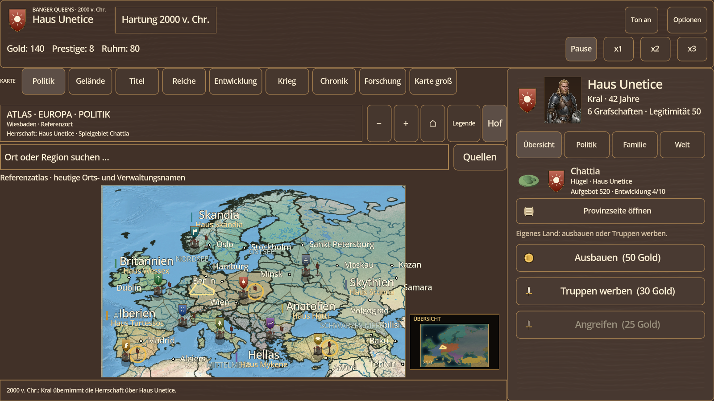
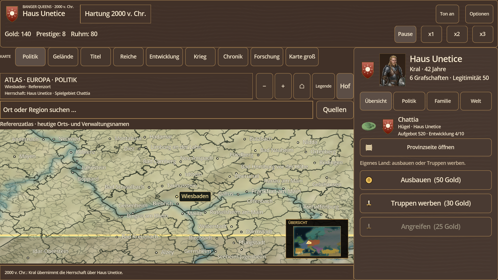
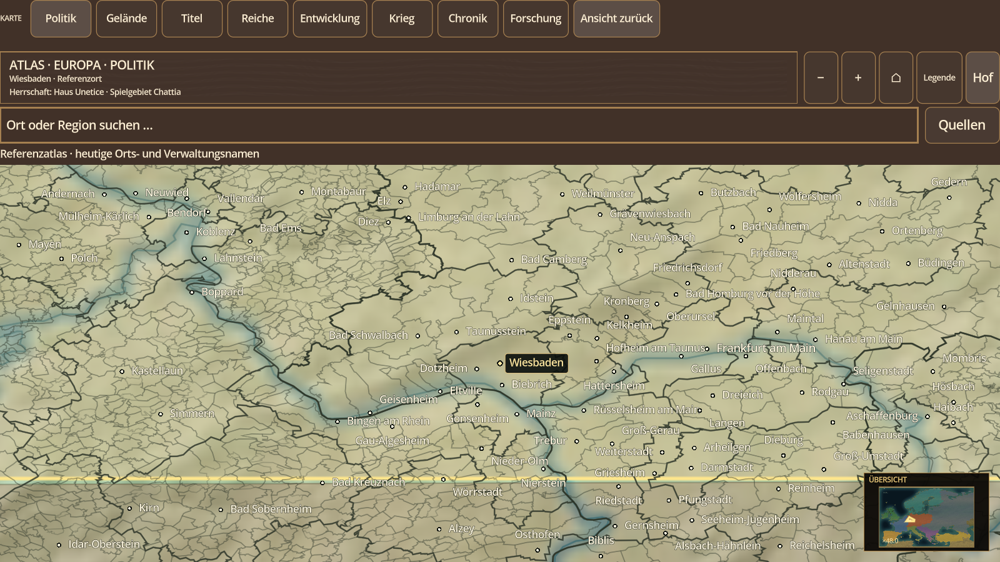
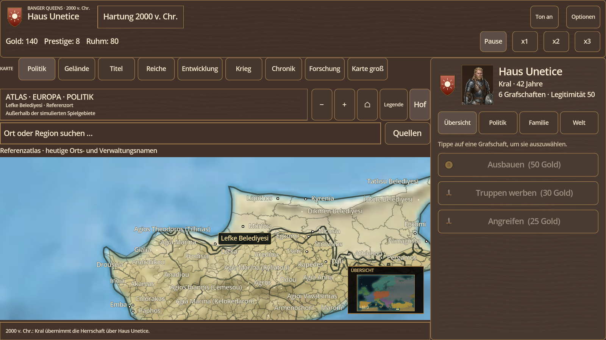
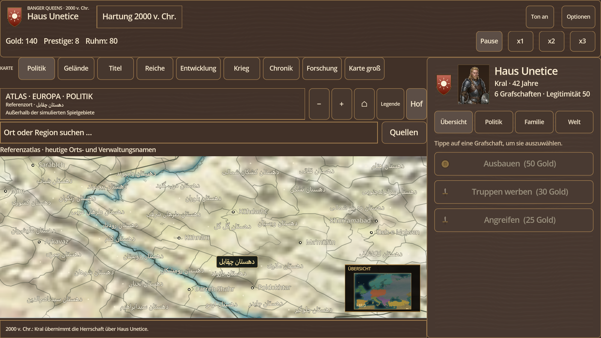
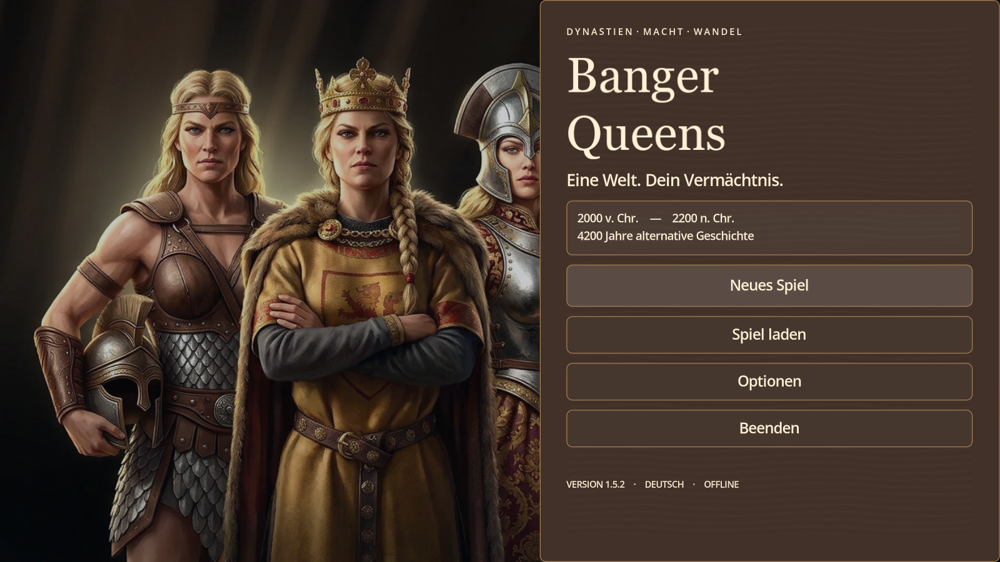
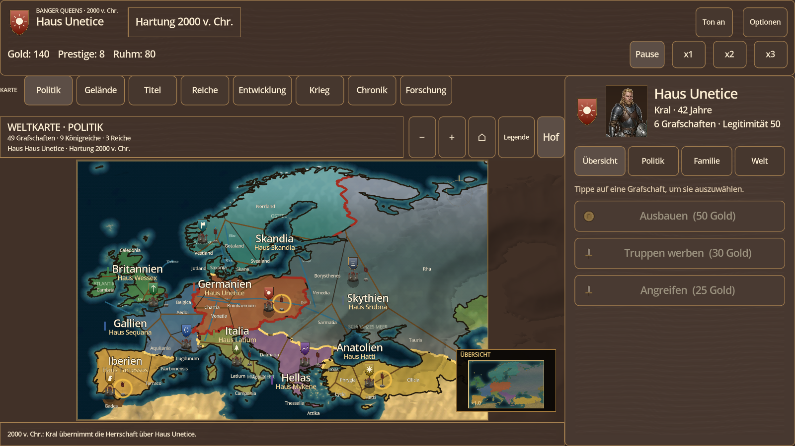

# Banger Queens

Eigenständige Grand Strategy für **Android und Windows**, gebaut mit Godot 4.5. Die vorhandene Fassung „Kronen und Kriege“ wird als **Banger Queens** weiterentwickelt. Ausgangspunkt bleibt die Europakarte mit 49 Grafschaften, 29 Herzogtümern, neun Königreichen und drei Reichen.

**Entwicklungsstand 1.6.1:** geografischer Referenzatlas mit echten Verwaltungsgrenzen, lesbaren Ortsnamen und Flüssen. Der geprüfte Bestand enthält 70 Länder-/Gebietsobjekte, 997 regionale und 4521 Kreis-/Bezirksflächen sowie 114761 kommunale Darstellungsflächen und 19222 weitere lokale Verwaltungsflächen. Deutschland enthält 16 Länder, 400 Kreise, 10.751 Gemeinden und 198 gemeindefreie Gebiete. Dazu kommen 23.463 GeoNames-Orte und 175 Flussgruppen. Frankreich, Italien, Spanien und das Vereinigte Königreich erhalten ihre tatsächlichen oberen Regionalebenen. Sieben der zuvor 15 offenen Gebiete erfüllen nun das begrenzte fachliche Prüfkriterium; **acht bleiben offen**. [Vorher-/Nachher-Bericht](docs/atlas-remaining-15-audit.md). **Die durchgehend vergleichbare Gesamtabdeckung bleibt teilweise offen**; die Quellenanzeige nennt tatsächliche Datenstände und jede landesweise Lücke. Natural Earth II liefert den geografischen Geländeuntergrund auf 4800×3040 Pixeln.

Der [ergänzende amtliche Quellenabgleich für Libyen und Israel](docs/atlas-open-source-followups.md) dokumentiert zusätzliche ausgeschlossene Treffer und die konkret noch fehlenden Grenzbelege. Produktdaten und Pakete von 1.6.1 bleiben dabei unverändert.

Der Atlas zeigt **Europa und Nachbargebiete**. Heutige Ortsnamen und Verwaltungsgrenzen dienen der geografischen Orientierung; sie werden im Spiel als „Referenzatlas“ bezeichnet. Die bestehenden **49 Spielgebiete** bilden weiterhin Wirtschaft, Eigentum, Krieg und Speicherstände ab. Die zusätzlichen Gemeinden sind kartografische Details. Historische Gebietswechsel über alle Epochen und eine vollständig auf Gemeinden aufgeteilte Simulation sind weitere Ausbauschritte. AAA bleibt das gestalterische Ziel; der aktuelle Stand belegt noch keine vollständige AAA- oder Weltkommunensimulation.

**Bedienung:** Orts- und Regionensuche mit antippbaren Treffern, Zoom bis 64× und „Karte groß“ für zusätzliche Kartenfläche; ESC stellt die normale Ansicht wieder her. Kreise erscheinen ab 6×, Gemeinden ab 24× und erst bei mindestens 256 Pixel² projizierter Begrenzungsfläche. Ortsnamen werden priorisiert und kollisionsgeprüft statt auf wenige Pixel verkleinert: mindestens 13 Canvas-Pixel bei 100 % und 26 bei 200 % Textgröße. Suchtreffer und Quellen stehen in begrenzten schwebenden Rollbereichen. [Quellen und Datenstände](docs/atlas-sources.md), [Raster-Herkunft](data/atlas_terrain_source.json), [Atlas-Entwurf](docs/superpowers/specs/2026-11-09-atlas-design.md) und [Atlas-Prüfbericht](docs/atlas-progress.md) dokumentieren Daten, Umsetzung und den jeweiligen Prüfstand.

Die sechs gespeicherten Oberflächenstile aus 1.5.2 bleiben unter „Lesbarkeitsthema“ verfügbar. **Holz · Walnuss** ist der Standard für neue Einstellungen; **Holz · Helle Eiche** und **Pergament** ergänzen **Dunkler Atlas**, **Hoher Kontrast** und **Heller Atlas**. Deren bestehende Einstellungs-IDs `0`, `1` und `2` bleiben erhalten; die neuen Stile verwenden `3`, `4` und `5`. Die eigene, prozedural erzeugte Holzmaserung blockiert keine Touch-Eingaben. Hausfarben bleiben beim Stilwechsel unverändert; Einfügecursor, Platzhalter, Fokus, deaktivierte Aktionen und Zeitsteuerung sind auf die jeweiligen Flächen abgestimmt.

Das neue Hauptmenü, reservierte Kartennavigation und gegliederte Seitenpanel bleiben erhalten. Ereignisaktionen enthalten farbige Werte (grün/rot/gelb) innerhalb desselben Buttons; die Ereignisfläche hat 10 % Deckkraft, Kontur und Schatten. Das alte Logo/Banner des Hintergrundmotivs wird vollständig vom Menübereich abgedeckt. Dazu kommen Kalender ohne Jahr null, Save-Schema 12, erste Forschung und auf der Karte sichtbarer Straßenbau. Der Kalender reicht bis 2200; die vollständigen Epochen, Forschungszweige und langfristigen Nachfolgesysteme sind weitere Ausbaustufen. Sie sind durch die Datumsgrenze allein noch nicht implementiert.

Lokale Exportziele: `build/exports/banger-queens-1.6.1.exe` und `build/exports/banger-queens-1.6.1.apk` (auf dem derzeit verfügbaren Laufwerk C:). Die Atlasdaten werden mit JSON und binärem Geometriepool in beiden Exporten eingebettet; beim Spielen ist kein Netzwerkdownload oder manueller Import vorgesehen. Der [Atlas-Prüfbericht](docs/atlas-progress.md) unterscheidet den aktuellen Quellstand von tatsächlich geprüften Exporten. Die geprüfte Testfassung ist [Banger Queens 1.6.1](https://github.com/chaotiKKK/kronen-und-kriege/releases/tag/v1.6.1), mit Windows-EXE, vollständiger Offline-APK und SHA-256-Prüfsummen. Der reale Poco-Gerätelauf dieser Fassung bleibt offen. Den vorherigen Themen-/Exportstand dokumentiert der [Bericht zu 1.5.2](docs/banger-queens-progress.md). Die späteren Release-1.3-Angaben beschreiben ausdrücklich den früheren Stand.















Die folgenden Bilder der Herrscher-Werkstatt und des Stammbaums zeigen einen älteren Oberflächenstand:


## Architektur und bestehende Spielsysteme

Die systemische Tiefe ist in versionierten Dokumenten festgehalten:

- [`docs/waves.md`](docs/waves.md) — Wellenplan und Exit-Gates
- [`docs/ui-kernel.md`](docs/ui-kernel.md) — UiKernel-Zuschnitt und abgeschlossene Extraktion
- [`docs/depth-contract.md`](docs/depth-contract.md) — Depth Contract und 30-Minuten-Messlatte
- [`docs/manual-acceptance.md`](docs/manual-acceptance.md) — ausführbares 30-Minuten-Prüfprotokoll für Windows und Android
- [`docs/interaction-matrix.md`](docs/interaction-matrix.md) — Kanten der vier Säulen mit Quelle, Ziel und Zustandsgröße
- [`docs/save-schema.md`](docs/save-schema.md) — Schema 12, Migration und Nachweis

Der Save ist migrationfest: Schema 1 wird beim Laden auf Schema 12 gehoben; Gebäude, `victory`, Legitimität, Fraktionen, Geheimnisse, Ansprüche, Armeen, Flotten, Truces, Traits, Erziehung, Verteidigung, Belagerung, Blockaden, Ruhm, Vermächtnisse, Vasallenverträge, Ratssitze sowie Hofpracht, Reliquien, Hofhalle, Hofausstattung, Konfession, Frömmigkeit, heilige Stätten, Kirchenmacht, Ketzerei, Reformstufe und heiliger Krieg werden additiv ergänzt. Schema 12 ergänzt den Kalender ohne Jahr null sowie Forschung und Straßenbau. Die erwartete Hofpracht wird aus Provinzbesitz und Legitimität abgeleitet, nicht gespeichert. Ein JSON-Roundtrip liefert denselben Zustand. Der Nachweis läuft über `SaveMigrationTest` mit einem echten Altstand als Fixture. Die Systemtiefe umfasst alle 59 Matrixkanten: H1–H8, D1–D8, K1–K7, L1–L3, AI1–AI5, V1–V3, C1–C5, R1–R8 und F1–F12; Spieler und KI benutzen denselben `SystemicResolver` und dieselben `Game`-Kommandos. `SystemicDepthTest`, `FullDepthTest`, `DynastyTest`, `CouncilTest`, `CourtTest` und `FaithTest` prüfen positive Ketten und Negativkontrollen, `StoryTest` spielt 120 Monate mit drei Save-Roundtrips.

**Dynastie-Vermächtnis (Welle 5):** Jede Dynastie sammelt monatlich Ruhm aus Prestige, Besitz und Diplomatie; Ehen und Geburten geben zusätzlichen Ruhm. Drei Zweige mit je drei Stufen werden über `unlock_legacy()` gekauft: Kriegsvermächtnis (+10 % Armeestärke und Angriffskraft je Stufe), Kronvermächtnis (+2 Gold jährlich je Stufe, +2 Legitimität bei Freischaltung) und Ränkevermächtnis (+3 Prozentpunkte Intrigenchance je Stufe). Der Herrschaftsbildschirm zeigt Ruhm, Zweig, Stufe, Kosten und die drei neuen Blender-Token; die KI kauft über dieselbe Methode.

**Vasallenverträge und Rat (Welle 6):** Drei Vasallen pro Haus haben je eine Vertragsstufe `0..2` mit Steuern `2/5/8`, Aufgebot `0/30/60` und Meinung. `change_vassal_contract()` verlangt Gold (`60/80`), Legitimität (`50/60`) und Prestige (`8/16`), senkt oder hebt die Meinung und schreibt die Wirkung über `V1`–`V3` in Gold, Armee und Legitimität. Der Rat hat vier Sitze (Marschall, Kanzler, Kämmerer, Spionmeister), deren Besetzung Stimmen und laufende Effekte bestimmt. Vier Beschlüsse (`war_levy`, `land_frieden`, `crown_tax`, `shadow_network`) brauchen drei von vier Stimmen und das zustimmende Schlüsselamt; Kosten und Wirkung laufen über `C1`–`C5`. Die KI nutzt dieselben APIs und Kosten, hält aber eine Goldreserve.

**Hofpracht und Reliquien (Welle 7):** Jedes Haus besitzt `court` mit `relics`, `hall` und der abgeleiteten `grandeur` (`0..100`). Drei einzigartige Reliquien — Krone der Ahnen, Klinge des ersten Königs und Siegel des Schattenrats — kosten Gold und Prestige und geben je `+15` Hofpracht sowie `+10` Legitimität, `+80` Hauptstadtaufgebot oder `+2` Intrigenpunkte. Die Hofhalle wird in drei Stufen für `80/140/220` Gold und `5/10/15` Prestige ausgebaut. Hofpracht gibt jährlich Prestige (`R5`) und ab 60 Vasallenmeinung (`R6`); die Kanten `R1`–`R4` verbinden Reliquien und Halle mit Herrschaft, Krieg, Intrige und Hof. Ein eigener Bildschirm „Hof & Reliquien“ zeigt die vier neuen Blender-Assets, Kosten, Besitz und den nächsten Ausbau. Die KI schmiedet und baut über dieselben Kommandos.

**Glaube und Kirche (Welle 8):** Jedes Haus besitzt `faith` mit `confession`, `piety` (`0..100`), bis zu drei `holy_sites` und der abgeleiteten `church_power` (`0..100`). Drei Konfessionen — Sonnenbund, Mondorakel und Erdbund — geben jährlich +1 Legitimität, +1 Intrigenpunkt oder +1 Prestige. Die Wallfahrt kostet 30 Gold und gibt +12 Frömmigkeit; eine heilige Stätte kostet 60 Gold und 15 Frömmigkeit und gibt +6 Prestige; eine Bekehrung kostet 80 Gold und 15 Prestige und senkt die Vasallenmeinung um 6. Die Kirchenmacht folgt aus Basis 5, Frömmigkeit/4, 10 je Stätte, 5 je Reliquie und dem Konfessionsbonus (Sonne 6, Mond 3, Erde 0) und gibt ab 60 Vasallenmeinung +1, ab 80 +2 (`F1`–`F7`). Der Bildschirm „Glaube & Kirche“ zeigt drei Blender-Token, die Tempelkulisse, Kosten und Wirkungen; Spieler und KI rufen dieselben Kommandos `pilgrimage()`, `consecrate_site()` und `convert_faith()` auf.

**Ketzerei, Reform und heiliger Krieg (Welle 9):** Jedes Haus führt `heresy` (`0..100`), `reform` (`0..3`) und einen laufenden `holy_war` mit Zielhaus und Restlaufzeit. Ketzerei wächst jährlich um 4 bei Kirchenmacht unter 40 und zusätzlich um 2 bei Legitimität unter 35; ab 70 Kirchenmacht sinkt sie um 3, jede Reformstufe senkt den Zuwachs um 2 (`F11`). Ab 40 Ketzerei sinkt die Legitimität jährlich um 1, ab 70 um 2 (`F8`); ab 30 Ketzerei sinkt die Vasallenmeinung um 1 je 30 Punkte, maximal 3 (`F9`). Das Ketzergericht kostet 50 Gold und 10 Prestige und senkt die Ketzerei um 25. Eine Reform kostet `100/150/200` Gold, `25/30/35` Frömmigkeit und `10/15/20` Prestige, gibt +4 Kirchenmacht je Stufe (`F10`), senkt die Ketzerei um 10 und die Vasallenmeinung um 4; ab 60 Ketzerei ist sie gesperrt. Ein heiliger Krieg kostet 60 Gold, 20 Frömmigkeit und 10 Prestige, senkt die Meinung um 3 und erhebt 24 Monate Anspruch auf die Hauptstadt eines Andersgläubigen oder Ketzers; die Eroberung gibt +10 Prestige und +5 Legitimität (`F12`) über die bestehenden Kriegskanten K1/K2. Der Glaubensbildschirm zeigt Ketzerei, Reformstufe, Kosten und alle Kriegsziele mit echten Buttons; die KI nutzt dieselben Kommandos `suppress_heresy()`, `reform_faith()` und `declare_holy_war()`.

**Hofpracht 2.0 (Welle 10):** Die Hofpracht steht jetzt relativ zu einer Erwartung aus Provinzbesitz und Legitimität: `5 + 2 * eigene Provinzen + Legitimität / 5`, geklemmt auf `0..100`. Der Hofbildschirm zeigt den Korridor und die aktuelle Füllung, die bestehende Blender-Hallenkulisse trägt Zielmarke und Pips für Tafel, Gemächer und Gefolge. Jede der drei Linien hat drei Stufen, gibt `+5` Hofpracht und einen eigenen Sekundäreffekt (Vasallenmeinung, Diplomatie oder Hauptstadtaufgebot); der Ausbau kostet `50/90/140` Gold, der Unterhalt `8` Gold je Stufe und Jahr. `R8` bucht jährlich einen spürbaren Bonus über Erwartung bzw. Malus darunter. Spieler und KI nutzen dieselben Kommandos und den zentralen Resolver; `court.amenities` wurde mit Schema 11 eingeführt und wird im aktuellen Schema 12 persistiert und aus Reliquien, Halle und Ausstattung validiert.

## Frühere Downloads und Abnahme: Version 1.3

Die veröffentlichten Testversionen liegen auf GitHub: [Kronen und Kriege 1.2](https://github.com/chaotiKKK/kronen-und-kriege/releases/tag/v1.2). Release 1.3 mit dem Banger-Queens-Titelbild ist gebaut, für Windows geprüft und auf dem Android-Emulator sichtbar getestet, aber noch nicht veröffentlicht.

Die folgenden Hashes beschreiben die Release-1.3-Builds unter `F:`. Der 30-Minuten-Abnahmelauf am 2026-11-08 wurde gegen genau diese EXE gefahren und ist bestanden; Belege unter `build/verify/manual-build-922eb13/` und `build/verify/windows-start-current.log`.

### Android

| | |
|---|---|
| Datei | `F:\ck3-kronen-kriege.apk` |
| Größe | 180.708.021 Bytes (ca. 172 MiB) |
| SHA-256 | `3b17118a9ea7d4e307fec735b58cc4b46dcc459d4ca49a4edac30f71037dbbbf` |
| Zeitstempel | `2026-11-08 14:02:14` (CET) |
| Paket | `org.example.kronen`, versionCode 4, versionName 1.3 |
| SDK | minSdk 24, targetSdk 35 (compileSdk 35) |
| ABIs | `arm64-v8a`, `armeabi-v7a` (keine x86-Bibliotheken) |
| Signatur | APK Signature Scheme v2 gültig (`apksigner`); Debug-Zertifikat `CN=Android Debug`, RSA 2048; Zertifikat-SHA-256 `da3c6296edd521ad9f67d6d52d1cfe71fa5115e8d7ee0dfbca0a5c2c663802ac`; `zipalign -c 4` ok |
| Einstieg | Launchable Activity `com.godot.game.GodotApp` |
| Inhalt | APK mit Wappen, Porträts, Icons, Karten- und Audiodaten |

Installation: Datei aufs Gerät kopieren und dort öffnen (Installation aus unbekannten Quellen erlauben) oder

```
adb install -r "F:\ck3-kronen-kriege.apk"
```

### Windows

| | |
|---|---|
| Datei | `F:\ck3-kronen-kriege.exe` |
| Größe | 138.795.936 Bytes (ca. 132 MiB) |
| SHA-256 | `922eb13b62b8150a065f5132cd4506142fc44ad057692b7e740f0fd31ec1d6b1` |
| Zeitstempel | `2026-11-08 21:33:43` (CET) |
| Version | 1.3.0.0, Produkt „Kronen und Kriege“ |
| Format | einzelne x86_64-EXE mit eingebetteter PCK, eigenem Icon und Versionsressourcen |
| Start | Doppelklick auf die EXE; `F11` schaltet Vollbild |
| Geprüft | Startcheck für 1.3 grün: Fenster `1618x945`, Titel „Kronen und Kriege“, `MAIN_READY version=1.3`, Exit 0, keine Fehlerzeilen. 30-Minuten-Abnahmelauf am 2026-11-08 (`21:34:29–22:04:31`, 30:02) gegen diese EXE **BESTANDEN**: 12/12 Aktionen, 3/3 Roundtrips ohne Save-Diff, AI-Pass (AI2+AI3), regulärer `run_end`. Belege: `build/verify/windows-start-current.log`, `build/verify/manual-build-922eb13/acceptance-result.json` |

### Release-Verifikation

Die beiden automatischen Abnahmen sind reproduzierbar:

```
bash tools/verify_android_apk.sh "F:/ck3-kronen-kriege.apk"
powershell -NoProfile -ExecutionPolicy Bypass -File tools/verify_windows_start.ps1
```

Die APK-Prüfung bestätigt mit `apksigner` `Verifies`, APK Signature Scheme v2, genau einen Signer und das Debug-Zertifikat. `aapt dump badging` weist Paket, Version, minSdk/targetSdk, Launchable Activity und beide ABIs aus; `zipalign -c -v 4` bestätigt die Ausrichtung. Die Windows-Prüfung startet die EXE ohne erzwingenden `--quit-after`, wartet auf `MAIN_READY`, prüft Fenster, Sichtbarkeit und einen nichtleeren Render-Frame, schließt per `WM_CLOSE` und verlangt Exit 0 sowie keine `ERROR`-/Exception-Zeilen. Der Screenshot liegt unter `build/verify/windows-start.png`. Der Startcheck war für den aktuellen 1.3-Build grün (`MAIN_READY version=1.3`, Exit 0; Beleg `build/verify/windows-start-current.log`). Der vollständige 30-Minuten-Lauf gegen die 1.3-EXE ist im [Abnahmeprotokoll](docs/manual-acceptance.md#windows-lauf-2026-11-08) mit 12/12 Aktionen, 3/3 Roundtrips ohne Save-Diff und den KI-Kanten AI2+AI3 dokumentiert; Belege unter `build/verify/manual-build-922eb13/`, Tiefen-Gegenprüfungen in `build/verify/acceptance-FullDepthTest.log` und `build/verify/acceptance-SystemicDepthTest.log`. Die einzige Log-Warnung ist die umgebungsbedingte Godot-Meldung zu Windows-Common-Controls; sie ist keine Fehlerzeile.

## Spielinhalt

- **Start 2000 v. Chr.** mit eigener Zeitrechnung („Hartung 2000 v. Chr.“), 49 Grafschaften, 29 Herzogtümern, neun Königreichen und drei Reichen.
- **Herrscher-Werkstatt:** Klick bzw. Tipp auf Porträt oder Wappen öffnet die Gestaltung. Dort lassen sich Porträt, Wappen, Hausfarbe, Name, Hausname, Geschlecht, Alter und die vier Charakterwerte ändern. Die Vorschau aktualisiert das Hofpanel, die Karte und den Spielstand; „Abbrechen“ stellt den Ausgangszustand wieder her.
- **Eigenes Haus gründen:** Name des Herrschers, Name der Dynastie, Name des Landes, Geschlecht, Heimatgrafschaft und 20 frei verteilbare Gaben (Kriegskunst, Diplomatie, Verwaltung, Intrige). Die gewählte Grafschaft geht an dich und kann umbenannt werden.
- **Echte Assets statt Platzhalter:** neun Wappen, zwölf Porträts, zehn Icons, Pergament-Oberfläche, Bronze-Buttons, Titelpanorama sowie See- und Geländetexturen für die Karte. Alles wird von Skripten im Projekt erzeugt; nichts stammt aus Crusader Kings.
- **Familie:** Heiraten, Beilager, Schwangerschaft über neun Monate, Geburt, Kindesalter, Erbfolge. Das Erbfolgegesetz wählt das älteste oder jüngste Kind. Kinder erhalten eigene Porträts.
- **Stammbaum:** eigener Bildschirm mit Herrscher, Gemahl/in, Ehe-Linie und Kindern samt Porträts; rechts steht die nummerierte Erbfolge. Erreichbar über „Stammbaum“ im Hofpanel.
- **Intrigen:** Verführen (Geliebte/r, heimliche Schwangerschaft, Skandalrisiko), Ermorden (Nachfolge, Entdeckungsrisiko), Entführen (Gefangener, Lösegeld oder Zwangsheirat), Haltungen der Häuser und Abklingzeiten.
- **Herrschaft:** Rat besetzen, Erbfolge und Steuersatz ändern, Markt, Kaserne oder Mauern bauen; Legitimität, Prestige, Faktionen, Truppen und Verteidigung sind sichtbar. Das Modal bündelt diese Entscheidungen.
- **Krieg & Diplomatie:** Ansprüche schmieden und erheben, Armeen aufstellen, Belagerungen vorantreiben, Provinzen einnehmen, Frieden mit Waffenstillstand schließen. Nur ein Anspruch erlaubt einen Angriff; Freundschaft und laufende Truces blockieren ihn.
- **Geheimnisse:** Aufdecken und Ausnutzen erzeugt Skandal, Haltungsverlust und einen Anspruch auf die Zielhauptstadt.
- **Hof und Welt:** Ausbau, Truppen werben, Angriffe, Hof halten, jährliches Einkommen, alternde Herrscher, acht Ereignisse mit Entscheidungen.
- **Speichern/Laden** inklusive eigener Häuser, Gemahl, Kindern, Schwangerschaft, Geliebten, Gefangenen, Haltungen, Abklingzeiten sowie gewähltem Porträt, Wappen und Hausfarbe (`user://spielstand.json`).
- **Touch-Bedienung:** Karte und Porträt verarbeiten `InputEventScreenTouch`; Buttons laufen über die Maus-Emulation aus Touch.

## Häuser

| # | Haus | Heimat | Herrscher |
|---|---|---|---|
| 0 | Haus Unetice | Germanien | Kral |
| 1 | Haus Sequana | Gallien | Brennus |
| 2 | Haus Wessex | Britannien | Belenos |
| 3 | Haus Tartessos | Iberien | Argantonios |
| 4 | Haus Skandia | Skandia | Sigrun |
| 5 | Haus Mykene | Hellas | Atreus |
| 6 | Haus Hatti | Anatolien | Pithana |
| 7 | Haus Srubna | Skythien | Targitai |
| 8 | Haus Latium | Italia | Lavinia |

Alle neun sind spielbar; drei davon werden automatisch durchgetestet.

## Eigenes Haus

Im Startmenü öffnet „Eigenes Haus gründen“ das Formular. Die 20 Punkte werden auf die vier Gaben verteilt (Startwert je 6, Maximum 20). Die Heimatgrafschaft wird aus den 49 Grafschaften gewählt; der bisherige Herrscher verliert sie, du übernimmst sie und kannst ihr im Feld „Land“ einen eigenen Namen geben. Start: 150 Gold, 12 Prestige, unverheiratet.

## Familie & Intrigen

| Aktion | Kosten | Abklingzeit | Wirkung | Risiko |
|---|---|---|---|---|
| Heiraten | 30 Gold | 12 Monate | Gemahl/in aus dem Zielhaus, +10 Prestige, +20 Haltung | Ablehnung: −5 Prestige, −5 Haltung |
| Beilager | — | 6 Monate | Schwangerschaft (9 Monate), danach Kind und Erbe | keine |
| Verführen | 20 Gold | 12 Monate | Geliebte/r, +8 Prestige, +12 Haltung, ggf. heimliche Schwangerschaft | Öffentlichkeit: −8 Prestige, −15 Haltung; Skandal |
| Ermorden | 60 Gold | 18 Monate | Zielherrscher stirbt, Nachfolge tritt ein | Entdeckung: −15 Prestige, −15 Haltung bei allen |
| Entführen | 45 Gold | 18 Monate | Gefangener für 12 Monate | Scheitern: −10 Prestige, −20 Haltung |
| Lösegeld | — | — | +80 Gold, +5 Prestige, Gefangener frei | −10 Haltung |
| Zwangsheirat | — | — | Gefangene/r wird Gemahl/in | −30 Haltung, −10 Prestige |

Chancen hängen von Diplomatie, Intrige, Kriegskunst, Gesundheit, Prestige und der Haltung des Zielhauses ab. Die Zielauswahl zeigt Haltung, Prozentchance und Kosten; nicht mögliche Aktionen sind ausgegraut.

## Steuerung

| Eingabe | Wirkung |
|---|---|
| Tippen auf eine Grafschaft | Grafschaft auswählen |
| Tippen auf Porträt oder Wappen | Herrscher-Werkstatt öffnen |
| Buttons im Seitenpanel | Ausbauen, Werben, Angreifen, Heiraten, Beilager, Verführen, Ermorden, Entführen, Hof halten |
| Hof & Reliquien | Öffnet den Hofbildschirm mit Reliquien, Hofhalle und Hofpracht |
| Herrschaft | Rat wechseln, Erbfolge/Steuersatz umstellen, Markt/Kaserne/Mauern bauen, Ansprüche, Armee, Belagerung, Frieden und Geheimnisse |
| Stammbaum | Öffnet den Stammbaum mit Ehe, Kindern und Erbfolge |
| Pause / x1 / x2 / x3 | Zeit anhalten oder beschleunigen |
| Speichern / Laden | Spielstand schreiben oder lesen |
| F11 (Windows) | Vollbild umschalten |
| Escape | Hof, Herrschaft oder Herrscher-Werkstatt schließen; Änderungen verwerfen |

## Starten

```
cd mobile-godot
.tools/godot.exe --path .
```

## Assets erzeugen

```
cd mobile-godot
powershell -NoProfile -ExecutionPolicy Bypass -File tools/make_assets.ps1
powershell -NoProfile -ExecutionPolicy Bypass -File tools/make_audio.ps1
powershell -NoProfile -ExecutionPolicy Bypass -File tools/make_icon.ps1
```

Die Skripte schreiben nach `assets/`:

- `ui/title.png`, `ui/card.png`, `ui/button.png`
- `map/sea.png`, `map/terrain.png`
- `crests/crest_0..8.png`
- `portraits/portrait_0..11.png`
- `icons/icon_{gold,prestige,sword,heart,ring,mask,dagger,chain,crown,scroll}.png`
- `audio/ambient.wav`, `audio/click.wav`, `audio/open.wav`
- `icon.png`, `icon_192.png`, `icon.ico`

Danach importiert Godot die Dateien beim nächsten Start.

## Builds

Android:

```
bash export_android.sh
```

Windows:

```
bash export_windows.sh
```

Beide Skripte setzen `APPDATA` auf `.tools/appdata`, löschen das alte Artefakt und schreiben nach `F:`. Android nutzt JDK 17 und die Gradle-Vorlage in `android/build`; Windows nutzt die Release-Vorlage, bettet die PCK ein und ruft rcedit für Icon und Versionsinformationen auf.

Wichtig für den Nachbau:

- `APPDATA` wird auf `.tools/appdata` umgebogen, damit Godot Editor-Settings und Exportvorlagen aus dem Projekt liest.
- In `.tools/appdata/Godot/editor_settings-4.5.tres` stehen Android-SDK/JDK/Keystore sowie der Pfad zu `rcedit-x64.exe`.
- `gradle_build/use_gradle_build` steht in `export_presets.cfg` auf `true`; die Versionsmarke `android/.build_version` enthält `4.5.stable`.
- Windows benötigt `windows_release_x86_64.exe` in `.tools/appdata/Godot/export_templates/4.5.stable/` und `rcedit-x64.exe` in `.tools/`.

## GitHub-Release

Die Testversionen werden als GitHub-Release veröffentlicht. Nach einem Versionssprung in `project.godot` und beiden Exporten:

```bash
bash export_android.sh
bash export_windows.sh
bash tools/publish_github_release.sh
```

Das Skript liest `config/version`, verlangt einen sauberen `main`-Arbeitsbaum, prüft die APK-Signatur, pusht den Commit und den Tag `v<version>` und lädt `F:/banger-queens.apk`, `F:/banger-queens.exe` und `SHA256SUMS.txt` als Banger-Queens-Pre-Release hoch. Ein vorhandener Release kann zusätzliche Assets erhalten, sofern der Tag auf dem aktuellen Commit liegt. Gleichnamige Assets werden nicht überschrieben; der Upload bricht bei einem Namenskonflikt ab.

## Tests

Alle Tests liegen unter `tests/` und werden nicht in die Builds exportiert; `build/` ist ebenfalls aus beiden Exporten ausgeschlossen.

```
cd mobile-godot/.tools
APPDATA="$PWD/appdata" ./godot.exe --headless --path .. res://tests/MapDataTest.tscn
APPDATA="$PWD/appdata" ./godot.exe --headless --path .. res://tests/MapTest.tscn
APPDATA="$PWD/appdata" ./godot.exe --headless --path .. res://tests/HouseTest.tscn
APPDATA="$PWD/appdata" ./godot.exe --headless --path .. res://tests/HousePlayTest.tscn
APPDATA="$PWD/appdata" ./godot.exe --headless --path .. res://tests/IntrigueTest.tscn
APPDATA="$PWD/appdata" ./godot.exe --headless --path .. res://tests/CustomizeTest.tscn
APPDATA="$PWD/appdata" ./godot.exe --headless --path .. res://tests/PortraitTest.tscn
APPDATA="$PWD/appdata" ./godot.exe --headless --path .. res://tests/SaveMigrationTest.tscn
APPDATA="$PWD/appdata" ./godot.exe --headless --path .. res://tests/DynastyTest.tscn
APPDATA="$PWD/appdata" ./godot.exe --headless --path .. res://tests/DynastyUiTest.tscn
APPDATA="$PWD/appdata" ./godot.exe --headless --path .. res://tests/SystemicDepthTest.tscn
APPDATA="$PWD/appdata" ./godot.exe --headless --path .. res://tests/FullDepthTest.tscn
APPDATA="$PWD/appdata" ./godot.exe --headless --path .. res://tests/StoryTest.tscn
APPDATA="$PWD/appdata" ./godot.exe --headless --path .. res://tests/UiKernelTest.tscn
APPDATA="$PWD/appdata" ./godot.exe --headless --path .. res://tests/EventArtTest.tscn
APPDATA="$PWD/appdata" ./godot.exe --headless --path .. res://tests/CourtTest.tscn
APPDATA="$PWD/appdata" ./godot.exe --headless --path .. res://tests/CourtUiTest.tscn
APPDATA="$PWD/appdata" ./godot.exe --headless --path .. res://tests/CouncilTest.tscn
APPDATA="$PWD/appdata" ./godot.exe --headless --path .. res://tests/CouncilUiTest.tscn
APPDATA="$PWD/appdata" ./godot.exe --headless --path .. res://tests/NavalTest.tscn
APPDATA="$PWD/appdata" ./godot.exe --headless --path .. res://tests/FaithTest.tscn
APPDATA="$PWD/appdata" ./godot.exe --headless --path .. res://tests/FaithUiTest.tscn
APPDATA="$PWD/appdata" ./godot.exe --path .. res://tests/TouchTest.tscn --resolution 1280x720
APPDATA="$PWD/appdata" ./godot.exe --path .. res://tests/ShotTest.tscn --resolution 1280x720
APPDATA="$PWD/appdata" ./godot.exe --path .. res://tests/TitleShot.tscn --resolution 1280x720
APPDATA="$PWD/appdata" ./godot.exe --path .. res://tests/FaithShotTest.tscn --resolution 1280x720
```

Godot 4.5 muss vorhanden sein; die lokale `.tools/godot.exe` ist wie die übrige Toolchain nicht versioniert und muss in einem frischen Checkout separat bereitgestellt werden. `bash tools/run_all_tests.sh` registriert derzeit **41 Test-Suiten** unter `tests/` (29 headless, zwölf mit Fenster), schreibt je ein Log nach `build/tests/` und endet nur bei vollständig grünem Lauf mit Exit 0. Der Runner bricht bei einer unregistrierten Szene ab und akzeptiert ein Log nur mit positiver Assertion-Zahl und ohne `skip`/`pending`/`todo`/`ignored`-/`FAIL`-Marker. Der Sammelbericht steht unter `build/tests/run_all_summary.tsv`; die tatsächlich abgeschlossenen aktuellen Läufe beschreibt der [Atlas-Prüfbericht](docs/atlas-progress.md).

`SaveMigrationTest` lädt den echten Altstand aus `tests/fixtures/legacy_v1.json`, migriert ihn auf Schema 12 und vergleicht erhaltene Altfelder sowie einen JSON-Roundtrip. Fehlende Pflichtfelder und manipulierte abgeleitete Werte müssen erkannt werden. `CampaignTest` prüft den Kalender ohne Jahr null; `InfrastructureTest` und `InfrastructureUiTest` prüfen Forschung und Straßenbau samt Kosten, Voraussetzungen und Persistenz.

`DynastyTest`, `CouncilTest`, `CourtTest`, `NavalTest` und `FaithTest` prüfen Spielregeln, Kosten, Negativfälle, KI-Nutzung und Save-Roundtrips im aktuellen Schema 12. `SystemicDepthTest` und `FullDepthTest` decken die Matrixkanten ab; `StoryTest` spielt 120 Monate mit drei Save-Roundtrips. Die zugehörigen UI-Suiten lösen Käufe, Verträge, Ratsbeschlüsse, Hofausbau und Glaubensaktionen über die tatsächlichen Buttons aus.

`EventArtTest` prüft Ereignisbilder, Zuordnung, Manifest und Vektor-Fallback. `CustomizeTest` prüft die Herrscher-Werkstatt einschließlich Speichern/Laden und Abbrechen. `ModernUiTest`, `EventChoiceTest` und `MaterialThemeTest` prüfen Navigation, Textskalierung, farbige Aktionswerte, sechs Oberflächenstile und ihre Bedienzustände. `TouchTest` erprobt Eingaben im Test-Viewport. Die Screenshot-Suiten rendern Titel, Erstellung, Kartenmodi, Hof, Glaube, Stammbaum und Herrscher-Werkstatt. Diese Prüfungen ersetzen keinen aktuellen Spieltest auf einem physischen Android-Gerät.

`AtlasDataTest` prüft den eingebetteten Geometriepool, bekannte Ortspositionen, Suche, Sichtbereich und zoomabhängige Verwaltungsdetails. `AtlasIntegrationTest` verwendet die echte Hauptansicht für Ortsuche, Clipping, lesbare Beschriftungen, Minimapänderungen, Textskalierung und den vergrößerten Kartenmodus. Die vollständige Python-Sammlung besteht aktuell aus 391 Prüfungen für Quellenrollen, territoriale Schnitte, Integrität, Importer, Referenzen und Exportsicherheit; die Rastergeoreferenzierung bleibt gesondert geprüft.

## Toolchain im Projekt

| Pfad | Inhalt |
|---|---|
| `.tools/godot.exe` | Godot 4.5.stable |
| `.tools/jdk17/` | Temurin JDK 17.0.20.1 |
| `.tools/appdata/Godot/export_templates/4.5.stable/` | Godot-4.5-Exportvorlagen inkl. Windows x86_64 |
| `.tools/appdata/Godot/editor_settings-4.5.tres` | SDK-/JDK-/Keystore-/rcedit-Pfade |
| `.tools/keystores/debug.keystore` | Debug-Key (Alias `androiddebugkey`) |
| `.tools/rcedit-x64.exe` | Icon- und Versionsressourcen der Windows-EXE |
| `android/build/` | Android-Buildvorlage aus `android_source.zip` |
| `tools/verify_android_apk.sh` | Signatur-, Zertifikats-, Zipalign- und Badging-Prüfung der APK |
| `tools/verify_windows_start.ps1` | Start-, Fenster-, Render-Frame- und Shutdown-Prüfung der EXE |

Android SDK: `C:\Users\HP\AppData\Local\Android\Sdk` (build-tools 36.1.0, Platform 35).

## Aufbau

```
project.godot
export_presets.cfg        Android- und Windows-Preset, ABIs, Paketname, Zielpfade
scenes/Main.tscn          nur die Wurzel, die UI entsteht zur Laufzeit
scripts/Data.gd           Bronzezeit-Provinzen, Häuser, Familien, Ereignissescripts/Game.gd          Simulation, Familie, Intrigen, Speicherstand
scripts/SaveGame.gd      Schema 12, Migration, Validierung, kanonischer Diff
scripts/SystemicResolver.gd  zentraler Effektpunkt für Welle-1-Kanten

scripts/MapView.gd        texturierte Karte, Wappen, Touch- und Mausauswahl
scripts/FamilyTree.gd     zeichnet Stammbaum, Ehe-Linie und Erbfolge
scripts/Main.gd           Startmenü, Erstellung, Hofpanel, Herrscher-Werkstatt, Stammbaum, Zeitlauf
assets/                   eigene Wappen, Porträts, Icons, Karten-, UI- und Audiodaten
tools/                    Asset-, Audio-, Icon- und Release-Verifikationswerkzeuge
tests/                    Karten-, Haus-, Intrigen-, Anpassungs-, Touch- und Bildtests
android/build/            Android-Buildvorlage (nicht Teil des Exports)
export_android.sh         Android-Build
export_windows.sh         Windows-Build
```

## Prüfstand 1.5.2

Der abschließende Sammellauf besteht mit **38 von 38 Suiten und 3.722 Prüfungen**: 27 Suiten headless, elf mit Fenster, ohne übersprungene oder ausstehende Fälle. `MaterialThemeTest` besteht im Fensterlauf mit 219 Prüfungen für sechs Themen, Kontraste, Hausfarben, Eingabefelder, Fokus, Zeitsteuerung und Ereignisse. Die zugehörigen Exportprüfungen werden im [Prüfbericht](docs/banger-queens-progress.md) getrennt vom Quelltest dokumentiert. Ein aktueller Spieltest auf dem Poco ist damit nicht nachgewiesen.

### Historischer Prüfstand bis Version 1.3

Die folgenden Einzelzahlen, Hashes, Emulatorbelege und manuellen Abnahmen stammen aus dem früheren Stand. Sie gelten nicht als Nachweis für die heutigen Exportdateien.

- `MapDataTest`: 49 Grafschaften, 29 Herzogtümer, 9 Königreiche, 3 Reiche, keine ungültigen Flächen, alle 49 Nachbarschaften vorhanden.
- `MapTest`: Auswahl, Hierarchie, eigener Grafschaftsstart und Karten-UI funktionieren.
- `HouseTest`: neun Häuser im Menü, drei Häuser angespielt und ausgebaut.
- `HousePlayTest`: Wessex, Skandia und Latium je 18 Monate simuliert, gespeichert und geladen.
- `IntrigueTest`: Heirat, Beilager, Verführen, Mord mit Nachfolge, Entführung mit Lösegeld, Stammbaum und Speichern/Laden.
- `SaveMigrationTest`: echter v1-Altstand geladen, auf Schema 11 migriert, alle Altfelder erhalten, Legitimität/Faktionen/Verteidigung/Flotten/Ruhm/Vermächtnisse/Vasallen/Rat/Hof/Ausstattung/Glaube ergänzt, JSON-Roundtrip identisch; negative Kontrollen erkennen entferntes `dev`, `legitimacy`, `renown`, `defense`, manipulierte Hofpracht, manipulierte Kirchenmacht und manipulierte Ketzerei.
- `DynastyTest`: 42 Prüfungen für Startruhm, monatlichen Gewinn, drei Stufen und Kosten, Armee-/Gold-/Intrigenwirkung, Maximalstufe, deaktivierte Kante L1, KI-Kauf, UiKernel-Route und Schema-11-Roundtrip.
- `DynastyUiTest`: echter Herrschaftsbildschirm, Ruhm-Anzeige, drei Blender-Token und Zweige, Buttonkauf und aktualisierte Stufe; 14 Prüfungen.
- `CouncilTest`: drei Vasallenverträge, vier Ratssitze, Stimmen, vier Beschlüsse, KI, Negativfälle und Schema-11-Roundtrip; 76 Prüfungen.
- `CouncilUiTest`: sieben neue Token, echter Vertragsbutton, echter Landfrieden-Button, sichtbare Gold-, Meinungs- und Legitimitätsänderung; 22 Prüfungen.
- `CourtTest`: drei Reliquien, drei Hallenstufen, Hofpracht, drei Ausstattungslinien, Erwartung, Jahresunterhalt, R1–R8, KI, Negativfälle und Schema-11-Roundtrip; 197 Prüfungen.
- `CourtUiTest`: echter Hofbildschirm, vier Blender-Token, Zielkorridor, drei Ausstattungs-Pips, Schmieden-, Hallen- und Tafelbutton; 39 Prüfungen.
- `CourtShotTest`: echter 1600×900-Hofbildschirm mit Zielmarke und Ausstattungsstufen (`build/ui_court_hall3.png`).
- `FaithTest`: drei Konfessionen, Wallfahrt, Weihe, Bekehrung, Ketzerei, Reform, heiliger Krieg, F1–F12, Reliquien-/Frömmigkeitskopplung, KI-Kosten, Negativfälle und Schema-11-Roundtrip; 225 Prüfungen.
- `FaithUiTest`: echter Glaubensbildschirm, drei Konfessionstoken, Wallfahrts-, Bekehrungs-, Weihe-, Ketzergerichts-, Reform- und Heiliger-Krieg-Button; 95 Prüfungen.
- `FaithShotTest`: drei echte 1600×900-Screenshots (`build/ui_faith.png`, `build/ui_faith_wave9.png`, `build/ui_court.png`).
- `SystemicDepthTest`: H1, H2, H5 (Kaserne), D5 und AI1 positiv; alle fünf Negativkontrollen ohne Zieländerung; D5→H1-Kreislauf belegt.
- `FullDepthTest`: 74 positive/negative Prüfungen für H3–H8 (inkl. Mauern), D1–D4, D6–D8, K1–K7, AI2–AI5, Gelände und Versorgung.
- `StoryTest`: 120 Monate, 101 Entscheidungen, 47 Kanten, 3 Save/Load-Roundtrips ohne Diff; 7 dynastische, 6 Krieg-/Diplomatie- und 5 KI-Kanten.
- `UiKernelTest`: 35 Prüfungen für Auswahl, Modalstapel, blockierte und gültige Kommandos, Save-Grenze und View-Model-Strings.
- `PortraitTest`: 48 HD-Porträts, Auswahlbereiche und Speichern/Laden grün.
- `CustomizeTest`: Porträt-Klick, Wappen, Hausfarbe, Name, Hausname, Geschlecht, Alter und Werte; Speichern/Laden und Abbrechen grün.
- `TouchTest`: Auswahl per `InputEventScreenTouch` und Ausbau per Touch.
- `ShotTest`: elf gerenderte Bilder, inklusive sechs Kartenmodi und Herrscher-Werkstatt.
- `TitleShot`: Titelbild, Hausauswahl und Ladebildschirm gerendert.
- `EventArtTest`: acht Ereignisse, acht eindeutige Bilddateien, acht Cache-Treffer, leeres Manifest-`open` und Vektor-Fallback; 98 Prüfungen.
- Sammellauf `tools/run_all_tests.sh`: 23 Headless-Suiten (inklusive `TickBench`) und sieben Fenstersuiten (`TouchTest`, `ShotTest`, `TitleShot`, `NavalRenderTest`, `MapPerfTest`, `FaithShotTest`, `CourtShotTest`) mit Exit 0; der Runner prüft Discovery, Exit-Code, Assertion-Zahl und Skip-/Pending-Marker. Die Main-basierten Tests laufen ohne Audio- und Ressourcen-Leak-Warnungen.
- Android: Schema-4-Export erfolgreich (Exit 0), 180.708.021 Bytes, SHA-256 `3b17118a9ea7d4e307fec735b58cc4b46dcc459d4ca49a4edac30f71037dbbbf`; `apksigner` bestätigt v2, einen Signer und das Debug-Zertifikat; `zipalign` ok; Badging: `org.example.kronen`, versionCode 4/versionName 1.3, minSdk 24, targetSdk 35, Activity `com.godot.game.GodotApp`, ABIs `arm64-v8a`/`armeabi-v7a`. Bei der letzten Prüfung sah ADB das autorisierte Gerät `f030379a` (Android 16, Modell `24117RK2CG`); während der Prüfung war kein reales Gerät verbunden; der Ziel-Emulator `emulator-5554` wurde für den Host-GPU-Test neu gestartet. Die frühere APK 1.2 wurde mit `adb install -r` installiert (Exit 0), die Activity kalt gestartet (`Status: ok`); der Prozess lief nach 15 Sekunden noch ohne FATAL-/Script-Error. Die aktuelle APK 1.3 ist auf `emulator-5554` (AVD `fhd36`, Android 16) mit Host-GPU (`-gpu host`, NVIDIA RTX 5070 Laptop) installiert und rendert dort sichtbar: Ladebildschirm bei 82 % und Hauptmenü, `MAIN_READY version=1.3`, kein FATAL. Der frühere SwiftShader-Start scheitert an `GL_MAX_FRAGMENT_UNIFORM_VECTORS (261)`; auf realer Hardware wurde sie nicht installiert, daher bleiben die reale Sichtprüfung und der Android-30-Minuten-Lauf offen.
- Windows: Schema-4-Export erfolgreich (Exit 0), **138.795.936 Bytes**, SHA-256 `922eb13b62b8150a065f5132cd4506142fc44ad057692b7e740f0fd31ec1d6b1`, eingebettete PCK, Audio und Versionsressourcen `1.3.0.0` vorhanden. Der Startcheck meldet `MAIN_READY version=1.3`, Fenster `1618x945` und keine `ERROR`-/Exception-Zeilen (`build/verify/windows-start-current.log`). Der vollständige 30-Minuten-Abnahmelauf am 2026-11-08 (`21:34:29–22:04:31`, 30:02) war gegen diesen 1.3-Build **BESTANDEN** (12/12 Aktionen, 3/3 Roundtrips ohne Save-Diff, AI2+AI3, `status=BESTANDEN`). Belege: `build/verify/manual-build-922eb13/acceptance-result.json`, `build/verify/acceptance-FullDepthTest.log`, `build/verify/acceptance-SystemicDepthTest.log`.

## Historisches Abnahmeprotokoll: Version 1.3

Automatisch nicht möglich sind nur diese Punkte. Das ausführbare Prüfprotokoll mit sechs Zeitfenstern, Evidenztabelle und Abbruchregeln steht in [`docs/manual-acceptance.md`](docs/manual-acceptance.md).

1. **Installation und Start auf einem realen Android-Gerät.** Das Android-SDK liegt unter `C:\Users\HP\AppData\Local\Android\Sdk`; `adb` ist nicht im PATH. Bei der letzten Prüfung zeigte der direkte Aufruf von `C:\Users\HP\AppData\Local\Android\Sdk\platform-tools\adb.exe devices` das autorisierte Gerät `f030379a` (Android 16, Modell `24117RK2CG`); während der Prüfung meldete derselbe Aufruf kein reales Gerät; der Ziel-Emulator `emulator-5554` und ein Gegencheck-`emulator-5556` waren verbunden; die aktuelle APK 1.3 ist auf `emulator-5554` (AVD `fhd36`, Android 16) mit Host-GPU installiert, startet bis `MAIN_READY version=1.3` und rendert Ladebildschirm und Hauptmenü sichtbar. Auf realer Hardware wurde sie nicht installiert; die reale Sichtprüfung bleibt offen. Der Keyguard war bei der früheren Prüfung aktiv. Zum manuellen Nachtest Gerät per USB verbinden, entsperren und:

   ```
   "C:\Users\HP\AppData\Local\Android\Sdk\platform-tools\adb.exe" install -r "F:\ck3-kronen-kriege.apk"
   "C:\Users\HP\AppData\Local\Android\Sdk\platform-tools\adb.exe" shell am start -n org.example.kronen/com.godot.game.GodotApp
   ```

   Danach „Neues Spiel“ wählen, Karte und Porträt antippen, einen Ausbau und Speichern/Laden auslösen und auf Abstürze prüfen.

2. **Menschlicher 30-Minuten-Spielauf auf Android.** Der Windows-Lauf ist am 2026-11-08 gegen den 1.3-Build **BESTANDEN** (12/12 Aktionen, 3/3 Roundtrips, AI2+AI3; [Laufprotokoll](docs/manual-acceptance.md#windows-lauf-2026-11-08)). Für Android bleibt eine vollständige Partie über 30 Minuten inklusive mehrerer Entscheidungen, Speichern/Laden, Krieg/Diplomatie und Sichtprüfung offen; sie ist kein automatisierbarer Nachweis. Die automatischen Tests decken die Spiellogik, die Start-EXE und die Touch-/Bildpfade ab, aber nicht das Langzeitverhalten auf realer Hardware.

## Quellen der Spielmotive und Kartendaten

Banger Queens verwendet eigene Spielmotive und separat lizenzierte geografische Referenzdaten. `tools/make_assets.ps1` erzeugt die ursprünglichen Spielmotive; die Oberfläche verwendet den Godot-Standardfont. Der Atlas ergänzt den Natural-Earth-II-Geländeuntergrund und die dokumentierten amtlichen beziehungsweise offenen Verwaltungs- und Ortsdaten. Für diese Geodaten gelten die je Quelle ausgewiesenen Lizenzen und Urheberhinweise. [Quellenmanifest und Verarbeitung](docs/atlas-sources.md) sowie die Quellenanzeige im Spiel erhalten Herkunft, Datenstand, individuelle Nutzungsbedingungen und bekannte Einschränkungen.
