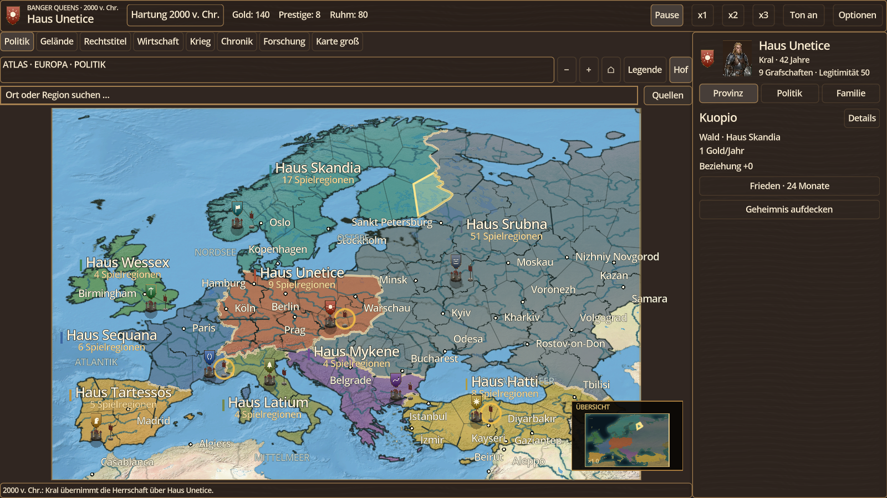

# Banger Queens 1.9.1 · Kontextverwaltung und Baustoffhandel

**Prüfstand vom 18. November 2026:** Beide Pakete sind gebaut und statisch geprüft; die APK-Signatur ist bestätigt. Die tatsächliche neue EXE besteht 8127 Prüfungen in drei Suiten; die funktionalen Android-Prüfungen für Laden/Speichern, Touchsuche, Fremdverwaltung und helles UI mit 200 Prozent Text sind bestanden. Das ursprüngliche Testprofil ist vollständig wiederhergestellt, der eigene Emulator und sein privater ADB-Server sind beendet. Der neue Stand verwendet Version **1.9.1**, **Android-Code 22** und **Spielstandschema 18**.

## Endgültiger Paketstand

| Paket unter `build/exports/` | Bytes | SHA-256 |
|---|---:|---|
| `banger-queens-1.9.1-trade-delivery.exe` | 321550072 | `06dce2f4cb9cc1ee9553c357efc76cb581ce62f317c0d67165f51fb4637f5dd5` |
| `banger-queens-1.9.1-trade-delivery.apk` | 270518146 | `53af3f4868babe771bc53209e41122cc384b43263d1e51fa97662c6fbacdee32` |

Die hashgleichen Downloadkopien liegen unter `C:/Users/HP/Downloads/banger-queens-1.9.1-trade.exe` und `.apk`. Beide wurden frisch angelegt und vollständig gegen die gehashten Lieferpakete verglichen; `downloads-receipt.json` bestätigt Größe, SHA256 und den Verzicht auf Überschreiben. Die älteren gleichnamigen Dateien unter `build/exports/` und die Zwischenkandidaten mit `-trade-final` bleiben getrennt erhalten und sind **nicht** diese Auslieferung. Die vorherigen Compact-/Production-Pakete und ihre Berichte bleiben ebenfalls erhalten.

Der neue Freeze `build/verify/material-trade-20261118/frozen-delivery2/source-manifest.json` enthält **1133 Eingaben**, **57 Laufzeitmodule** und **24 kanonische Datenressourcen**. Manifest-SHA256: `073bde9115222057acf91147634462b4b84ec4b6b58fa211addd52add92a56bb`.

Die vollständige Source-/Remap-/Bytecode-Zuordnung ist bijektiv. EXE und APK enthalten identische kompilierte Spielmodule, kanonische Daten und plattformunabhängige Ressourcen. Alle Laufzeitdaten des eigenständigen Banger Queens sind eingebettet; kein separater Import, Wine oder Box64 wird benötigt. Entwicklungsdateien und Schlüssel sind ausgeschlossen. Die vier nativen ELF-Bibliotheken entsprechen der eingefrorenen Godot-Vorlage; die APK enthält `arm64-v8a` und `armeabi-v7a`.

Die APK besteht CRC-/ZIP-, Ausrichtungs- und V2-Signaturprüfung mit genau einem Signer: Zertifikat-SHA256 `298739811808ab3c59ef84fd3a0db8bf44f574840c0166b35585079b1c3f6677`. Manifest:1.9.1/22, minSdk 24, targetSdk 35. Windows nennt Datei-/Produktversion1.9.1.0. Belege: `delivery2-package/production-static-review.json`, `static-package-receipt.json` und `root-independent-review.json`. Der zusätzliche Root-Abgleich besteht 1591 Prüfungen und verwendet eigene Vergleichsschleifen mit dem bestehenden PCK-Leser. Er ist ausdrücklich kein zweiter unabhängiger PCK-Parser und keine Laufzeitprüfung.

## Weniger doppelte und unpassende Bedienung

- **Fremde Provinz:** keine eigene Bau-, Schwerpunkt- oder Forschungsverwaltung. Diplomatie bleibt erreichbar; Krieg erscheint bei tatsächlichem militärischem Bezug. Es gibt keinen eigenen Verwaltungskatalog für fremdes Land.
- **Eigene Provinz:** fertige Gebäude, Entwicklung, Depot und Straßen stehen kompakt als Bestand. Genaue Stufen und Monatswerte öffnen sich über Details. Während eines örtlichen Bauauftrags verschwinden zusätzliche örtliche Kaufaktionen bis zu Fertigstellung oder Abbruch.
- **Ein Provinzinspektor:** Informations- und Aktionszugänge führen zur selben rechten Provinzseite. Der Hausbereich und die Provinzseite erzeugen keine zweite parallele Verwaltung.
- **Sinnvolle Aktionen:** volles oder übervolles örtliches Aufgebot zeigt keinen Werbebutton. Unterhalb der Kapazität kehrt er zurück; bei bloßem Geldmangel bleibt die mögliche Aktion sichtbar gesperrt. Optionen→Spiel enthält genau einen Speicherbutton, den vorhandenen Footer.
- **Straßen:** fertige Verbindungen werden zusammengefasst; leere Bereiche bleiben geschlossen. Kaufziel und Preis erscheinen einmal im jeweiligen Button.



Baustoffhandel ist ein anfangs geschlossener Bereich im vorhandenen Inspektor: bei eigenem Land unter **Ausbau**, bei fremdem Land unter **Diplomatie**. Er erscheint nur bei wirklichen Handelsmöglichkeiten oder relevanten Verträgen. Jede Zeile nennt einmal Richtung, Chargenmenge, Preis, Lieferstand, Restlaufzeit und aktuellen Grund beziehungsweise die vorsichtige Prognose. Angebot, Annahme und Beenden verwenden den bestehenden Game-/Kernelpfad. Alte Callbacks können nach Auswahl-, Besitzer-, Bestands- oder Vertragswechsel keine andere unbestätigte Transaktion auslösen.

## Zwei gezielt geschlossene Darstellungsfehler

**Suchtreffer und Touch:** Ein nativer Android-Touchlauf des früheren Kandidaten meldete `can_process` während der Trefferauswahl. Ursache war das sofortige Entfernen des gerade betätigten Suchbuttons aus dem Szenenbaum. `AtlasSearch._clear_results()` blendet alte Treffer jetzt sofort aus, deaktiviert sie und gibt sie am Frame-Ende frei. Derselbe 7395-Treiber erzeugt reale Down/Up-Touchfolgen für Lviv und Wiesbaden: zuvor zwei native Fehler trotz bestandener Szenenassertions, danach null. Der externe Logcheck weist den roten Lauf korrekt zurück. Beleg: `search-touch-fix/verification-record.json`.

**Neu erzeugte Buttons in hellen Themes:** Projektpriorität, Bauabbruch und Straßenaktionen behielten vorher zunächst die helle Standardtextfarbe. Die gemeinsame `_style_tool()`-Gestaltung speichert jetzt die originale Textrolle und wendet sofort die aktuelle Palette an. Zwei zentrale Produktzeilen schließen den Fehler. Der identische 573-Treiber erzeugt die Controls nach Wahl der Themes 2/4/5 bei 100/200 Prozent, prüft vier Textrollen und den aus tatsächlichen Panel-/Buttonfarben bestimmten linearen Kontrast≥ 4,5. Rot:54 gezielte Farb-/Kontrastfehler; Grün:0. Native-/Scriptfehler beider finalen Läufe:0. Alle älteren Assertions bleiben bytegenau erhalten; Welt und UI-Kontexte werden vollständig zurückgestellt. Beleg: `lighttheme-fix/source-stop-receipt.json`. Frühere Testaufbaufehler bleiben getrennt archiviert und werden nicht als Produkt-Rot gewertet.

Die fünf anschließenden betroffenen UI-Suiten bestehen 608 weitere Prüfungen: Touch2, ProvinceContext39, MaterialTradeUi147, RegularUi159 und MaterialTheme 261. Zusammen mit Province 573 ergeben sich **1181 gezielte Quellprüfungen nach der letzten Runtimekorrektur**. Alle Läufe verwenden den echten Windowsrenderer, kurze Privatprofile und den rechten DISPLAY3; native/Scriptfehler0. Die Handelsprüfung enthält sieben Maus-/sechs Touchaktionen und alle sechs Lesbarkeitsthemen. Text und Buttons umbrechen bei 100/200 Prozent; die bestehenden Touchziele und Scrollwege bleiben erhalten.

## Tatsächliche endgültige Windows-EXE

Die oben gehashte Delivery-EXE besteht **8127 Prüfungen in drei Suiten**. Alle verwenden das tatsächlich eingebettete PCK, unveränderte externe Treiber, leere Arbeitsverzeichnisse und eigene Profile. Das Quellprojekt wird nicht als Laufzeitressource eingebunden. Exitcodes0, keine nativen oder Scriptfehler.

| Suite gegen die tatsächliche Delivery-EXE | Prüfungen | Bilder |
|---|---:|---:|
| AtlasIntegrationTest, einschließlich echter Suchtreffer-Touchfolgen | 7395 | 26 |
| ProvinceUiSimplificationTest, einschließlich dynamischer heller Buttons | 573 | 15 |
| MaterialTradeRegularUiTest, tatsächliche normale Finanzierung/Bedienung | 159 | 6 |
| Gesamt dieser Paketläufe | 8127 | 47 |

Beleg: `delivery2-actual-exe-review.json`; unveränderte Treiber, Laufreceipts, Logs und Bilder liegen unter `build/verify/mt22datlas`, `mt22dprovince` und `mt22dregular`. Die alten978 Prüfungen des vorherigen Trade-Kandidaten bleiben dessen historischer Nachweis und werden nicht nochmals als neue Delivery-Läufe addiert.

## Spielmechanik

Werkstattüberschüsse lassen sich an ein anderes Haus verkaufen. Der Käufer erhält Baustoffe für seine Entwicklung; der Verkäufer entscheidet zwischen eigener Reserve und Gold durch Absatz. Der Handel erweitert die vorhandene Produktion, Baustellen und Versorgung. Baustoffe sind keine Nahrung; die heutige Atlasbevölkerung wird dadurch nicht zu einer simulierten historischen Bevölkerung.

Die beiden Endpunkte müssen direkt landbenachbarte Regionen verschiedener Häuser sein. Der Verkäufer besitzt die Ausgangsregion, der Käufer die Zielregion. Es gibt in dieser Erweiterung keine Handelsroute über See oder durch entfernte Drittgebiete.

| Regel | Verhalten |
|---|---|
| Angebot | Zeigt Richtung, vollständige Chargenmenge und Goldpreis. Beim Abschluss wechseln weder Geld noch Ware. |
| Menge und Preis | Werden beim Angebot festgelegt. Menge: `max(1, edge_weight_u(source,target))`; Preis: `max(1, ceil(2 × lot_u / UNIT))` Gold. Wirtschaftlich kleinere Regionen erhalten entsprechend kleinere Chargen. |
| Zustimmung | Ein menschlicher Gegenpart muss selbst annehmen. NPC-Zustimmung erfordert tatsächlich lieferbaren Überschuss, bezahlbare Ware und beim NPC-Käufer einen aktuellen Projektfehlbedarf. |
| Lieferung | Höchstens eine vollständige Charge pro Monat, frühestens im Monat nach der Annahme; höchstens drei Chargen pro Vertrag. Keine Teilcharge und keine Schulden. |
| Laufzeit | Angebotsmonat plus sechs Monate, Ablaufmonat eingeschlossen. Im Ablaufmonat kann ein bereits aktiver Vertrag noch liefern; eine erstmalige Annahme wäre dann zu spät für eine zukünftige Lieferung und wird begründet gesperrt. |
| Grenzen | Höchstens zwei aktive Verträge je Haus, ein selbst vorgeschlagenes offenes Angebot je Haus und 64 gespeicherte Verträge weltweit. Für dieselbe gerichtete Regionsbeziehung besteht höchstens ein Angebot oder Vertrag. |
| Pause | Fehlende Ware, Geld, Lagerraum oder NPC-Nachfrage sowie tatsächliche feindliche Stellung erklären die ausgebliebene Lieferung. Ein bloßer Anspruch ist noch kein Handelskrieg. |
| Ende | Drei Lieferungen, Ablauf, geänderte Eigentümer oder bewusstes Beenden schließen die Beziehung. Bereits bezahlte Ware und Geld werden beim Beenden nicht zurückgebucht. |

Die Handelsphase läuft nach der Jahresabrechnung und vor der örtlichen Produktion. Empfangene Ware kann deshalb in der anschließenden Arbeitsphase desselben Monats verbaut werden. Die reine Handelsplanung verwendet ausschließlich ursprüngliche Bestände, freie Lagerplätze und Anfangsgelder: Ware aus einem Kauf wird nicht im selben Handelsplan weiterverkauft; Verkaufserlöse finanzieren darin keine weiteren Einkäufe. Übergabe und Bezahlung erfolgen gemeinsam und erhalten Gold sowie Material über alle Parteien exakt.

Eigene örtliche Reserve, der Bedarf des nächsten Arbeitsmonats und bereits sinnvolle Lieferungen über das eigene Straßennetz haben Vorrang vor dem Verkauf. NPCs behalten ihre Militär-/Marinereserve. Mehrere Verträge teilen Anfangsgeld, Quellbestand und freien Lagerraum. NPC-Verträge mit demselben Ziel teilen außerdem dessen ursprünglichen tatsächlichen Fehlbedarf, damit zwei einzeln zulässige Chargen nicht zusammen über den Bedarf hinaus kaufen. Gleichberechtigte konkurrierende Verträge rotieren deterministisch nach Monat. Menschen können bewusst auf Vorrat kaufen.

NPCs schließen automatisch nur untereinander Verträge. Menschliche Kassen und Waren werden nicht ohne eine eigene Handelsentscheidung verplant. Ein bereits aktiver NPC-Vertrag kann bei abgeschlossener Baustelle mit einem konkreten Nachfragegrund pausieren, während ein anderer Vertrag desselben Hauses weiterliefert.

## Normale Finanzierung und tatsächliche Bedienung

`MaterialTradeCampaignTest` besteht **268 Prüfungen**. Zwei vorgegebene Welten mit Seeds `20261118` und `20261119` durchlaufen jeweils 24 reguläre Monate. Anfangsgold, Besitz, Forschung, Armeen und Güter werden nicht künstlich erhöht oder ergänzt. Alle normalen NPCs und ihre Entscheidungen bleiben aktiv.

Beide Läufe beginnen mit 140 Gold und bezahlen Lublins Werkstattschwerpunkt für drei Gold. Nach tatsächlich erwirtschaftetem Überschuss entsteht in Monat 4 ein bezahlbarer Verkauf an eine reale NPC-Baustelle. Drei spätere vollständige Chargen liefern zusammen 423243 interne Baustoffeinheiten und bringen drei Gold. Das ursprüngliche NPC-Projekt wird in Monat 8 fertig. Eine vor dem Angebot exakt kopierte Gegenwelt ohne menschlichen Vertrag, mit gleichen monatlichen Seeds und weiterhin normalen NPCs/Ereignissen, beendet dasselbe Projekt erst in Monat 13. Auch dort bleiben Geld und Güter erhalten. Das belegt einen tatsächlichen Unterschied der Materialzuteilung und Fertigstellungszeit in diesen beiden Proben; es ist keine allgemeine Balancegarantie für jede Kampagne.

Eine zusätzliche normale Main-/UI-Prüfung besteht **159 Prüfungen** unter dem Windows-Renderer, mit **acht Maus- und sieben ScreenTouch-Eingaben**, null Headless-Callback-Fallbacks und sechs tatsächlichen Bildern bei 100/200 Prozent:

1. Das echte Main startet Haus 0 mit unverändert 140 Gold, 108 Regionen und neun Häusern. Der Seed wird unmittelbar vor dem regulären Spielstart gesetzt.
2. Die vorhandene Schwerpunktvorschau bleibt zustandsneutral. Der vorhandene bezahlte UI-Button richtet Werkstätten in Lublin ein: 140 → 137 Gold.
3. Vier legale Monatswechsel führen zur wirklichen Verkaufsoption Lublin → `skythien__05`, NPC 7, dessen regulär bezahltes Ausbauprojekt 11.
4. Der sichtbare Angebotsbutton erzeugt Vertrag 1 über 141081 interne Baustoffeinheiten für ein Gold. Die NPC-Annahme verschiebt noch keine Ware und kein Gold.
5. Monat 5 liefert die ganze Charge; das Spielergold steigt 137 → 138. Die tatsächliche Produktionsledger des Käufers beginnt mit altem Bestand plus Handelszugang und weist 290608 Einheiten Verbrauch sowie den gleichen Arbeitsfortschritt des bestehenden Projekts aus. Der Lieferstand zeigt 1/3.

Die Provinzauswahl wird in dieser Suite über den normalen Main-/Kernel-Auswahlpfad vorbereitet. Ein geografischer Kartenklick ist damit nicht separat geprüft. Die bezahlte Schwerpunktentscheidung, das Ein-/Ausklappen und das Angebot laufen im Renderer hingegen durch tatsächliche Eingabeereignisse. Die Lieferung und spätere normale Produktion werden getrennt bilanziert; weiterlaufende Werkstattproduktion wird nicht fälschlich als Handelszugang ausgegeben. Die erste Liefermonatprobe allein behauptet nicht, dass die Importcharge für genau diesen ersten Arbeitsmonat unerlässlich war; den späteren Zeitunterschied belegt die getrennte Kampagnengegenprobe.

## Spielstände und Migration

Schema 18 ergänzt die globalen Felder `material_trades` und `trade_serial`. Unterstützte ältere Stände erhalten ausschließlich eine leere Vertragsliste und Seriennummer 0. Es entstehen weder nachträgliche Verträge noch Geld, Güter oder Arbeitsfortschritt. Produktionsbestände, Übertragsreste, bezahlte Projekte, Straßen und ursprüngliche Forschungsfristen bleiben erhalten.

Verträge werden vor der Normalisierung streng geprüft: unter anderem eindeutige IDs, zulässige Parteien und Nachbarregionen, festgelegte Menge und Preis, chronologische Daten und gültige Lieferzähler. Endliche ganze JSON-Zahlen werden akzeptiert und kanonisch als Integer gespeichert; Boolesche Zahlen, Brüche, NaN, unbekannte Felder und gefälschte Vertragswerte werden zurückgewiesen. Ein ungültiger Restore wird nicht durch Änderung vorhandener Güter passend gemacht.

Vor dem ersten lokalen Schema-/Layoutwechsel bewahrt der Speicherpfad die unveränderten Originalbytes; etwa eine regionale Schema-17-Datei als `.pre-schema-v17.bak`. Bereits vorhandene abweichende Sicherungen werden durch einen zusätzlichen Hashsuffix erhalten. Die separat gespeicherten LAN-Dateien verwenden ihren eigenen belegten `.pre-trade-schema17.bak`-Pfad.

Der selbstständige `MaterialTradeSaveTest` besteht **448 Prüfungen**; eine zusätzliche private Variante mit lokalem Ari17-Stand bestand **453**. Der vorhandene Migrationslauf bestand **2267 Prüfungen**. Der aktualisierte `ProductionSaveTest` besteht **252 Prüfungen**, einschließlich eines tatsächlich vom unveränderten veröffentlichten Production-Paket erzeugten Schema-17-Originals. Diese frische synthetische Kompatibilitätsdatei ist kein historischer persönlicher Nutzerspielstand. Bestehende private Originaldateien und archivierte Fixtures bleiben bytegleich. Der tatsächliche neue Android-Lauf wird unten gesondert ausgewiesen.

## LAN-Vertrag

Die Befehls-/Akteurprüfung besteht **103 Prüfungen**, die echte ENet-Integration **100 Prüfungen**. Nur die Absichten `material_trade_offer {from,to}`, `material_trade_accept {trade}` und `material_trade_cancel {trade}` werden übertragen. Haus, Preis, Menge, Laufzeit und Bestände stammen aus dem autoritativen Hostmodell. Unzulässige Felder, fremde Akteure, falsche Auswahl und Wiederholungen ändern weder Welt noch Logbuch.

In der echten Zweimenschpartie bleibt das Angebot über einen Hostmonat ungebucht. Erst die ausdrückliche Gegenannahme und ein weiterer regulärer Hostmonat liefern eine vollständig bezahlte Charge. Beide Peers halten danach identische Welt-Hashes und Handelszustände. Die Handelsregeln des reinen Moduls und die tatsächliche Game-Reserve-/NPC-Politik sind im Fingerabdruck und dessen Cacheidentität enthalten.

Eine belegte Vorgängerkennung ist ausschließlich für passende lokale Schema-17-LAN-Dateien zugelassen. Eine neue Netzwerkverbindung mit altem Fingerabdruck wird weiterhin getrennt. Lokale Dateimigration ist damit keine Freigabe, alte und neue Spielrevisionen gemeinsam zu verbinden. Diese ENet-Prozesstests auf Windows belegen keine reale Android-WLAN-Sitzung.

## NPC-Produktion und Frontversorgung

Der unveränderte 120-Monatsrahmen wurde auf eine vorab festgelegte Matrix aus zwei Seeds und zwei Menschenhäusern erweitert. Alle vier Welten bleiben enthalten, auch wenn schon eine frühere Probe erfolgreich wäre. Die Prüfung besteht **1411 Assertions** und beobachtet **868 tatsächlich bezahlte NPC-Aufträge**, **32 vollständige Produktions-/Transport-/Baufertigstellungsketten** und **sieben reale Frontlieferungen**:

| Seed | Menschenhaus | Monate | Bezahlte NPC-Aufträge | Vollständige Ketten | Frontlieferungen |
|---|---:|---:|---:|---:|---:|
| 20261118 | 0 | 120 | 209 | 9 | 0 |
| 20261118 | 2 | 120 | 222 | 6 | 0 |
| 20261119 | 0 | 120 | 207 | 10 | 3 |
| 20261119 | 2 | 120 | 230 | 7 | 4 |
| Gesamt | | | 868 | 32 | 7 |

Die ursprüngliche Seedgruppe bleibt ausdrücklich mit **null Frontlieferungen** dokumentiert. Sie wurde nicht gelöscht, verkürzt oder mit Geschenken passend gemacht. Alte Assertions, Ereignisregeln und 120-Monatsmaximum bleiben erhalten; es gab keine zusätzliche willkürliche Seedsuche.

Die vorausgehende enge A/B-Diagnose erklärte einen veränderten Weltverlauf: Mit automatischem NPC-Handel entstehen Depots teilweise früher, die jeweiligen fremden Heerstellungen sind bei ihrer Fertigstellung aber bereits erobert. Ohne automatische NPC-Handelsakquise fallen später andere Feldziele mit einem nutzbaren Depot zusammen. Eine exakt restaurierte reguläre Monat-95-Stellung liefert mit und ohne wieder eingeschaltete Handelsakquise in den Monaten 96–98 jeweils elf Versorgungseinheiten an dasselbe tatsächliche Heer. Diese Diagnose stammt ausdrücklich aus dem Stand vor dem zusätzlichen gemeinsamen NPC-Bedarfsbudget; sie ersetzt nicht die danach weiterhin offen ausgewiesenen Nullergebnisse der ursprünglichen Seedgruppe. Die abschließende Viererprobe prüft die normalen Welten mit der gemeinsamen Bedarfsbegrenzung.

Damit sind bezahlte zivile Ketten und reale Verringerungen des Versorgungsfehlbedarfs belegt. Ein daraus isoliert verursachter Sieg- oder Belagerungsvorteil ist in diesen normalen Viererproben nicht gemessen (`natural_frontier_effect_records=0`).

## Abgrenzung der Quellenmatrix

Der vollständige frühere V2-Lauf enthält 123 Suiten:122 PASS mit 44821 bestandenen Prüfungen und einen roten `LegacyLanMigrationTest`. Sein ursprüngliches TOTAL bleibt FAIL. Die historische Projektion hatte die zwei neuen leeren Handelsfelder nur auf der migrierten Seite belassen. Genau sechs ergänzte Testzeilen prüfen zuerst ausdrücklich `material_trades=[]`/`trade_serial=0` und entfernen erst dann diese additiven Felder aus dem Altwertevergleich. Keine frühere Assertion und keine Laufzeitregel wurde entfernt. Der korrigierte ursprüngliche Test besteht 1751 Prüfungen; Mutanten mit nichtleeren Handelsfeldern bleiben rot.

`regression-reconciled.json/.tsv` und `independent-regression-review.json` belegen 122 unveränderte V2-Suiten plus diesen gezielten Originaltest: **44821+1751=46572**,123 Suiten. **Es gibt keinen einzelnen vollständig grünen 123-Suiten-Lauf.**

Diese Matrix gehört zum vorherigen Freeze `frozen-release` mit ManifestSHA `e3ebde2030d8344aa043d65fd9e2fbe1007ffb4ed6a1f13bb45431b60783ecee`. Danach ändern sich zum endgültigen `frozen-delivery2` genau fünf Inputs: `AtlasSearch.gd`, `ModernInterface.gd`, ihre beiden bestehenden Testtreiber sowie die zusätzliche Atlas-Zulassung des Exporttest-Wrappers.1128 Eingaben bleiben bytegleich; darunter 55 Laufzeitmodule. Der zusätzliche Root-Paketabgleich bestätigt ebenfalls genau diese zwei geänderten Runtimepayloads und keine neue Bytecodeabweichung bei unverändertem Source. Die nachfolgenden 1181 Quell-/8127 tatsächlichen EXE-Prüfungen sind getrennte gezielte Nachweise, keine Umdeutung der historischen Matrix in einen neuen Sammellauf.

## Belegübersicht

Alle verkürzten Belegpfade liegen unter `build/verify/material-trade-20261118/`. Unterschiedliche Prüfstände werden nicht zu einer vermeintlichen Gesamtzahl addiert.

| Bereich | Umfang | Beleg |
|---|---:|---|
| Reine Vertragsplanung/gemeinsamer NPC-Bedarf | 201 | `pure/npc-needs/final-receipt.json` |
| Game-Integration | 85 | `game/shared-need-green.log` |
| Normale Handelskampagnen | 268 | `campaign/campaign-result.json` |
| Save18/Migration | 448, gesonderte Ari-Probe 453 | `save/result.json` |
| Bestehende Save-Migration/Produktionsstände | 2267/252 | `save/result.json`, `production-save-migration/RESULT.md` |
| Befehle/Akteure und echte ENet-Prozesse | 103/100 | `lan/game-policy-green.log`, `lan/lan-policy-final.log` |
| Vier normale NPC-Welten | 1411 | `npc-review/suite-four-probes/green/proof/npc-campaign-result.json` |
| Zusammengeführte frühere Quellenmatrix | 46572/123 Suiten | `regression-reconciled.json/.tsv` |
| Such-Touchkorrektur im Quellrenderer | 7395 | `search-touch-fix/verification-record.json` |
| Abschließende sechs betroffene Quell-UI-Suiten | 1181 | `lighttheme-fix/source-stop-receipt.json`, `delivery2-source-ui/source-ui-result.json` |
| Drei tatsächliche Delivery-EXE-Suiten | 8127 | `delivery2-actual-exe-review.json` |
| Zusätzlicher Root-Paketabgleich | 1591 | `delivery2-package/root-independent-review.json` |

Kontrollierte UI-/LAN-Grenzfälle verwenden ausdrücklich Fixtures. Nur als Normalkampagne beziehungsweise normale Main-Bedienung bezeichnete Läufe behaupten Finanzierung ohne Ressourcen-, Besitzer-, Forschungs- oder Armeegeschenke.

## Tatsächliche Android-Prüfung

Die endgültige APK mit SHA256 `53af3f4868babe771bc53209e41122cc384b43263d1e51fa97662c6fbacdee32` wurde im eigenen AVD `banger-queens-180-api36` in place von Code 22 auf 22 aktualisiert. Alle 65 ursprünglichen Einträge bleiben vor dem ersten Start unverändert; keine Deinstallation. Es handelt sich um einen x86_64-Emulator mit ARM64-Bridge `libndk_translation.so`, Host-GLES3.1 und NVIDIA-GPU. Das ist kein physisches Poco und kein Nachweis nativer ARM64-Hardwareleistung.

- Der echte Titel erscheint und das Menü reagiert. Frühe graue Initialisierungsbilder und ein fokussierter Titel nach dem Lade-Touch werden ausdrücklich nicht als fertiger Weltbeleg gewertet.
- Der ursprüngliche Ari17-Spielstand wird über das sichtbare Menü geladen und über den tatsächlichen Optionsfooter gespeichert. `migration-receipt.json` bestätigt Schema 18, `logical_changes=[]` und ein automatisch erzeugtes bytegleiches 17-Backup mit SHA256 `5475109fdbc4bbdf2e58305fabb7c0b840789e9cbabb840fbd0de22ea0e8bb47`. Gold 45 und die laufenden sechs Legacy-Forschungsmonate bleiben erhalten.
- Danach wird getrennt die unveränderte normale Windows-M4-Prüfwelt geladen: vier reguläre Monatswechsel nach Spielbeginn, Gold 137 nach dort bezahltem Werkstattschwerpunkt, kein künstliches Startguthaben. Damit wird kein erneuter Android-Neuspiel-/Werkstattkauf behauptet.
- Reale SDK-Toucheingaben geben **Lviv** in die sichtbare Suche ein und wählen den sichtbaren Treffer. Die Karte fokussiert Lviv und zeigt fremde Kriegs-/Diplomatie-/Anspruchsaktionen ohne eigene Bau-/Forschungsverwaltung. Suchliste und Eingabe werden geschlossen. Der nachfolgende prozessbezogene Logscan enthält null `ERROR:`, `SCRIPT ERROR` oder `can_process`-Zeilen; die App bleibt bedienbar.
- **Heller Atlas, 200 Prozent Text:** Die eigene Provinz Lublin zeigt einen lesbaren Ausbau-/Bestandsbereich mit Werkstätten, Markt und bedienbarem Scrollbereich. Diese Bilder belegen die eigene Bauansicht. Die speziellen neu erzeugten Projektprioritäts-/Abbruch-/Straßenrollen sind separat durch den 573-Test im tatsächlichen Windows-Paket geprüft; sie werden nicht als zusätzliche native Android-Rollenprüfung ausgegeben.

Der endgültige Lauf liegt unter `android-delivery/`: `acceptance-receipt.json` bindet Installation, Migration, Eingaben, Settings, Bilder und Logs mit Hashes an dieselbe APK und Session. Sein SHA256 ist `fcda961471614d638d748e469c6437f951fcf7f355c28b669abe18b6de889076`. Der frühere funktionale Teilbeleg mit noch offenem Cleanup bleibt getrennt erhalten. Ein neuer Android-Vertragsabschluss und Monats-/Lieferlauf wurden in dieser endgültigen Runde nicht separat geprüft. Die bezahlte Lieferung137→138 belegt der oben beschriebene tatsächliche Windows-Normallauf.

Der Geräteabschluss ist vollständig belegt: Alle 65 ursprünglichen Einträge sind nach dem temporären Test in Bytes, Dateitypen, Modi, UID/GID wieder gleich. Nach Gast-sync und erfolgreichem `emu kill` sind eigene QEMU-/Launcherprozesse beendet; der strikte Stop beendet ausschließlich den eigenen Server. Die privaten Ports 5039/5604/5605 sind frei. Die App wurde nach Restore nicht wieder geöffnet. `final-restore-receipt.json` und `shutdown-receipt.json` halten das fest. Der zusätzliche `root-final-review.json` vergleicht Original- und abschließendes Tar nochmals unabhängig einschließlich des Wurzelverzeichnisses; er bestätigt außerdem sämtliche referenzierten Belege und Downloadhashes, ohne ADB aufzurufen. Telefon und Standard-ADB 5037 bleiben unberührt.

Die früheren Versuche bleiben getrennt: Der alte Trade-Kandidat wurde unter CPU/SwiftShader installiert, zeigte wegen der Fragment-Uniformgrenze 261 aber eine graue, unbrauchbare Ansicht. Das war keine erfolgreiche UI-Abnahme. Unter Host-GPU ließen sich mit diesem früheren Kandidaten Ari17 laden, als18 speichern und das automatische17-Backup bytegleich nachweisen; eine normale M4-Welt zeigte fremde Diplomatie und einen per Touch abgeschlossenen Vertrag ohne Vorausbuchung. Dort wurde der oben korrigierte Suchfehler gefunden. Aus dem vorherigen M4-Puls wird keine Android-Lieferung oder Monat 5 behauptet.

CPU- und alter Host-Lauf sind vollständig beendet. Je 65 ursprüngliche Dateisystemeinträge wurden mit gleichen Bytes, Typen, Modi, UID/GID wiederhergestellt; die privaten Ports 5039/5604/5605 waren danach frei. Die historischen Restore-/Transport-/Stop-Fehler bleiben erhalten. Der seekable `exec-in`-Upload wird vor Extraktion bytegleich zurückgelesen. Zwei geschützte Cache-SGID-Bits werden ausschließlich im eigenen userdebug-Emulator nach strengem Vergleich repariert; das ist eine Testprofil-Reparatur, keine Rootanforderung der App. Beide bisherigen Abschlussreceipts und Stopbelege liegen unter `android/` beziehungsweise `android-host/`.

## Reproduktion und Prüfbedingungen

Die lokale Toolchain besteht aus Godot 4.5.1, JDK 17, AndroidSDK/build-tools36.1.0 und den vorhandenen Exportvorlagen/privaten Schlüsseln; sie ist nicht mit versioniert. Ziele müssen frisch sein. Vom Projektverzeichnis in PowerShell:

```powershell
python tools/prepare_windows_export_template.py --project .
python tools/release_validation/production_release_validation.py freeze --android-code 22 --schema 18 --output build/verify/local-trade-source
& 'C:\Program Files\Git\bin\bash.exe' export_windows.sh build/exports/local-trade.exe
& 'C:\Program Files\Git\bin\bash.exe' export_android.sh build/exports/local-trade.apk
python tools/release_validation/production_release_validation.py inspect --android-code 22 --schema 18 --frozen build/verify/local-trade-source/source-manifest.json --exe build/exports/local-trade.exe --apk build/exports/local-trade.apk --output build/verify/local-trade-package
```

Der Runner registriert 123 Suiten, 95 headless und 28 mit Fenster. Für sichtbare Tests gilt DISPLAY3 mit Position 1960,40. Kurze private APPDATA-Pfade vermeiden den separat reproduzierten Shader-Verzeichnisfehler bei 257–259 Zeichen; alte rote Initialisierungslogs bleiben erhalten. Native Fehler werden weiterhin als Fehler gewertet. Funktionale Rendererläufe sind kein isolierter FPS-Vergleich. Die im ursprünglichen GPU-Beleg beobachtete Fremdlast wird nicht als heutige Zustands- oder Ursache-Wirkungsbehauptung verwendet. Keine neue allgemeine60 FPS-Zusage wird abgeleitet.

## Auslieferung und verbleibende Arbeit

Die konkreten Downloadkopien sind oben bestätigt. Der Quellstand wird im bestehenden GitHub-Branch `codex/balanced-game-regions` geführt. Der abschließende lokale Lieferbeleg `release-acceptance.json` hält die tatsächlich bestätigte Remote-SHA fest; kein Hauptbranch-/Tag-/GitHub-Binärrelease wird aus dem Quellpush abgeleitet. Die 303 bereits fremden beziehungsweise generierten Änderungen bleiben außerhalb des Quellcommits.

Noch offen im umfassenden Spielziel:

- Physisches Poco, native ARM64-Hardwareabnahme und echtes Android-WLAN. Der eigene x86_64-Emulator mit ARM64-Bridge ersetzt diese Prüfungen nicht.
- Isolierte Kartenleistung, umfassende Langzeitbalance/weitere normale Handelswelten mit kleinen selbst gestalteten Häusern, weiterführende Forschung, Nahrung, Reichsziele und vollständige4200-Jahre-Inhalte. Die bestehende Spielspaß-/AAA-Zielarbeit bleibt aktiv.
