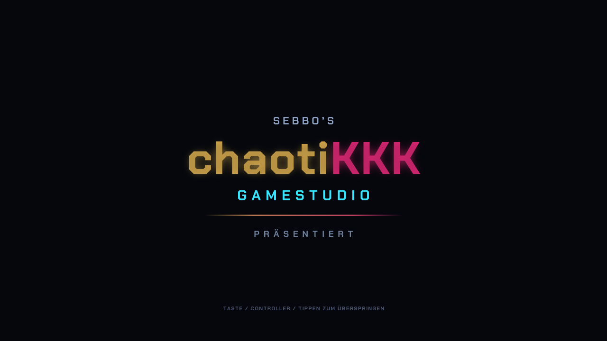
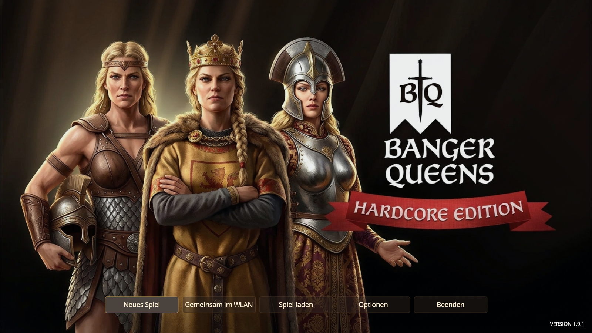

# Banger Queens 1.9.1

Das Hauptmenü liegt jetzt kompakt unten mittig im Titelbild. Die große rechte Menüfläche entfällt. Das vollständige Originalmotiv bleibt ohne Beschnitt sichtbar; bei abweichendem Seitenverhältnis ergänzen schwarze Ränder die Darstellung. Alle fünf Aktionen bleiben erhalten. Bei großer Schrift oder kleinerem Fenster werden die Buttons auf mehrere Zeilen verteilt. Die separate Anzeige **VERSION 1.9.1** steht unten rechts in Weiß mit dezentem Schatten und bleibt bei allen sechs Themes weiß.

## Studio-Logo beim Start

Die Datei `C:\Users\HP\Downloads\chaotiKKK_logo` ist ein PNG mit 2560 × 1440 Pixeln. Ihre Originalbytes wurden unverändert als `assets/ui/chaotiKKK_logo.png` eingebettet. Das Logo ist zugleich Godots erstes Startbild und anschließend eine undurchsichtige, vollständig eingepasste Einblendung für drei Sekunden. Erst danach wird die normale Titel-/Ladeansicht gezeichnet und das synchrone Laden der Hauptszene freigegeben. So bleibt das Logo nicht für die Dauer des Ressourcenladens stehen. Das Hauptmenü wird nach der notwendigen Vorbereitung bedienbar; die drei Sekunden sind die Logo-Anzeigedauer, keine Zusage für die gesamte Startzeit.

Original, Projektasset, EXE und APK enthalten dasselbe PNG mit SHA256 `980c3f40982e4872ed77d5dee3e068f2abae677d31020a901fddb04691db352c`.

## Version und Spielstände

Projekt und Android-Version heißen 1.9.1, Android-Versioncode ist 14, Windows-Datei- und Produktversion sind 1.9.1.0. Beide Pakete enthalten alle Laufzeitdaten. Der Android-Signierer entspricht 1.9.0/1.8.0. Die bereits dokumentierte Signaturgrenze gegenüber 1.6.1 bleibt bestehen.

Schema 13, Regionskatalog und Netzwerkprotokoll 3 bleiben erhalten. Alle verbundenen Spieler benötigen dieselbe Appversion. Gültige lokale 1.9.0-WLAN-Spielstände werden unter 1.9.1 mit identischem Inhaltsfingerabdruck und Regionskatalog übernommen. Die Originalbytes werden als `.pre-ui191.bak` gesichert; die Netzwerkversionsprüfung bleibt streng. Alte 1.7-/1.8-Migrationswege bleiben erhalten.

## Prüfungen

- Acht gezielte Quellsuiten mit insgesamt 488 Prüfungen erfolgreich: Titelmenü 69, moderne Oberfläche 38, Themes 261, WLAN-Oberfläche 10, Logo-/Ladephasen 22, lokale WLAN-Migration 27, LAN-Protokoll 28 und Netzwerk-Hausdesigner 33. Die neuen Verhaltensfälle wurden zuerst rot nachgewiesen. Diese gezielte Abnahme ist kein neuer vollständiger Lauf aller 62 registrierten Suiten.
- Tatsächlich exportierte Windows-EXE aus isoliertem Profil: 380 Prüfungen erfolgreich, einschließlich echtem Start über Loading.tscn, Logoaufnahme, Menüposition und -version, Charaktergründung, Spielverlauf, Speichern/Laden und eingebetteten Atlasdaten. Gemessene Logo-Phasendauer: 3,003 Sekunden. Das Logo verschwand vor dem synchronen Hauptszene-Lesen.
- Zwei getrennte Prozesse derselben fertigen EXE bestehen zusätzlich 66 tatsächliche ENet-/Main-Prüfungen mit gleichem abschließendem Welthash. Die neue Versionskennung funktioniert im Paket-Handshake; dies ist kein Nachweis von Smartphone-WLAN.
- Statische Prüfung aller 631 PCK- und 746 APK-Einträge, Datenhashes, Windowsressourcen und Originalmanifest sowie Android-Version, ARM64/ARMv7, V2-Signatur und ZIP-Ausrichtung erfolgreich. Das eingebettete Logo wurde zusätzlich bytegleich mit der Originaldatei verglichen.
- Sichtbare Windowsprüfungen ausschließlich auf dem rechten physischen Monitor. Für diese kleine Fassung keine neue Installation auf Poco oder Android-Emulator; die APK ist gebaut und statisch geprüft. Die früheren Grenzen bei realem Android-WLAN und Kartenleistung bleiben bestehen.

Nachweise: `build/verify/release-191/` und `build/tests/ui191-*.log`, `intro191-{red,green}.log`, `lan-ui191-*.log`. Die bestehenden Exportskripte verwenden Godot 4.5.1, die passenden Exportvorlagen, JDK 17 und Android-Ziel-SDK 35. Sie akzeptieren frische Zielpfade und grenzen lokale Werkzeuge/Diagnosen vom Ressourcenscan ab.

## Dateien

| Datei | Bytes | SHA256 |
|---|---:|---|
| `banger-queens-1.9.1.exe` | 321328360 | `6cb5b18232bfa3f4f1f463e74d130458762596538a990fd39ea2f6df715c1a2f` |
| `banger-queens-1.9.1.apk` | 270297699 | `80738d9f32321fbab8f4043d5e6cdbe9f94ac0d08ced4ac375f1285b4137bfb1` |

